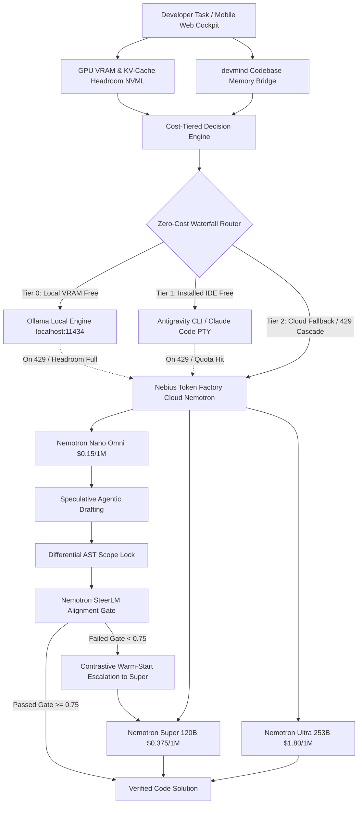

# Just-Enough-AI ⚡

> **Hardware-headroom, memory-aware, cost-tiered agentic coding harness & universal meta-harness.**  
> Built for the **Nebius × NVIDIA Global AI Hackathon** (Coding & Agentic Engineering Track).

---

## 🎯 What is Just-Enough-AI?

Modern AI coding agents burn through frontier model tokens (and dollars) on every keystroke, regardless of task complexity or local compute availability. Developers without continuous $20–$100/mo API budgets are locked out, even while possessing installed developer tools with generous free tiers.

**Just-Enough-AI** introduces a hardware- and memory-aware routing harness and **Universal Meta-Harness** that:
1. **Democratizes Free Compute (Zero-Subscription Access):** Discovers and bridges installed agentic IDE CLIs (**Google Antigravity**, **Claude Code**, **OpenCode**) and local engines (**Ollama** on `localhost:11434`) as zero-cost inference backends.
2. **Cascades Intelligently on Rate Limits:** When a free tier hits a 429 quota or rate limit, the harness automatically waterfalls to the next best provider or escalates to **NVIDIA Nemotron tiers on Nebius Token Factory** without dropping the user's task.
3. **Optimizes Cloud Tiers:**
   * **Nemotron Nano (Omni):** Lightning-fast, cost-efficient model ($0.15 / 1M blended tokens) for quick drafts and grounded tasks.
   * **Nemotron Super (120B):** Balanced multi-file reasoning model ($0.375 / 1M blended tokens) for refactoring and feature implementation.
   * **Nemotron Ultra (253B):** Frontier model ($1.80 / 1M blended tokens) reserved for ungrounded, high-complexity architectural challenges.

---

## 🌟 The 5 Breakthrough Engineering Innovations

| # | Breakthrough Feature | Technical Implementation | Citing Research / Standard |
|---|---|---|---|
| **1** | **Speculative Agentic Drafting** | Dispatches Nemotron Nano for a rapid 300ms draft ($0.0001). If deterministic checks fail, bundles failure trace into a *Contrastive Warm-Start Prompt* for Nemotron Super/Ultra. | *AgentSpec [arXiv:2608.24004], Speculative Actions [arXiv:2510.04371]* |
| **2** | **Physical KV-Cache Governor** | Monitors physical GPU VRAM via `pynvml`. Dynamically calculates $H_{KV}$ headroom ($2 \cdot B \cdot L \cdot H \cdot D \cdot \text{tokens}$), triggers AST context pruning, and prevents CUDA OOMs. | *Predictive Multi-Tier Memory [arXiv:2604.26968], KV Cache Wall [arXiv:2609.30854]* |
| **3** | **In-Harness SteerLM Alignment Gate** | Embeds NVIDIA's HelpSteer2 rubric as a runtime PR gate before code touches disk: $\text{Score} = 0.40\mathcal{C} + 0.30(1 - \mathcal{R}) + 0.20\mathcal{S} + 0.10\mathcal{V}$. | *HelpSteer2 [arXiv:2406.08673], HelpSteer2-Preference [arXiv:2410.01255]* |
| **4** | **Differential AST Scope Lock** | Parses symbol dependency closure via `devmind` and freezes all out-of-scope code as immutable. Diffs AST nodes before/after generation to roll back collateral damage. | *Compiler-grade AST isolation* |
| **5** | **Universal Meta-Harness & Failover** | Unified `ProviderAdapter` bridging direct APIs, local Ollama, Antigravity `agy`, and Claude Code PTY with zero-cost cascading failover on rate limits. | *Zero-Subscription Developer Democratization* |

---

## 🏗️ End-to-End System Architecture



---

## 🚀 Quickstart & Setup

This repository is managed with [uv](https://github.com/astral-sh/uv).

### 1. Clone & Setup
```bash
git clone https://github.com/Anishp-cell/Just-Enough-AI.git
cd Just-Enough-AI
```

### 2. Virtual Environment & Dependencies
```bash
# Using uv (recommended)
uv pip install -r requirements.txt

# Or install in editable mode with development tools
uv pip install -e ".[dev]"
```

### 3. Automatic Provider Detection (`jeai setup`)
Run the 1-command auto-detection wizard:
```bash
uv run jeai setup
```
The wizard will:
* Check for installed Google Antigravity (`agy`) CLI
* Check for installed Claude Code (`claude`) CLI
* Detect local Ollama daemon on `http://localhost:11434`
* Validate `NEBIUS_API_KEY` (if configured in `.env`)
* Write your personalized priority configuration to `~/.jeai/providers.json`

*(Note: If no cloud API key is present, Just-Enough-AI runs entirely in Zero-Cost Local / Mock mode with 100% feature availability!)*

---

## 💻 CLI Commands

```bash
# Show version & build metadata
uv run jeai version

# Run 1-command provider auto-detection wizard
uv run jeai setup

# Inspect local NVIDIA GPU VRAM headroom via NVML
uv run jeai profile

# View Nebius Token Factory Nemotron pricing tiers & cost comparisons
uv run jeai pricing

# Evaluate a task routing decision without burning tokens
uv run jeai route "Add an input validator to check if email contains @ and ."

# Calculate real-time physical KV-Cache memory budget
uv run jeai kv-budget "Refactor auth middleware"

# Run speculative drafting (Nano draft -> SteerLM verification -> Super escalation)
uv run jeai speculative "Add currency formatter to utils.py"

# Execute full self-fixing multi-step agent loop
uv run jeai loop "Refactor payment webhook to support idempotent retries"

# Launch headless FastAPI server with Web & Mobile Cockpit
uv run jeai server
```

---

## 📊 Benchmarking & Cost Efficiency

| Tier / Provider | Model / Backend | Cost / 1M Tokens (Blended) | Target Scenario | Cost Reduction vs. Ultra |
| :--- | :--- | :---: | :--- | :---: |
| **Tier 0 (Local Free)** | `Ollama Local (Nemotron-Mini / Qwen)` | **$0.00** | Offline, privacy-first, local VRAM | **100% Free** |
| **Tier 1 (IDE Free)** | `Google Antigravity / Claude Code` | **$0.00** | Interactive tasks, zero subscription | **100% Free** |
| **Tier 2 (Cloud Nano)** | `nvidia/nemotron-3-nano-omni` | **$0.15** | Grounded tasks + cloud speed | **91.6% Savings** |
| **Tier 2 (Cloud Super)** | `nvidia/nemotron-3-super-120b-a12b` | **$0.375** | Balanced refactoring & features | **79.2% Savings** |
| **Tier 2 (Cloud Ultra)** | `nvidia/Llama-3_1-Nemotron-Ultra-253B-v1` | **$1.80** | Ungrounded, high-complexity tasks | Baseline |

---

## 📱 Laptop-OFF Mobile Coding Experience

Just-Enough-AI is built for developers on the move:
1. Start the server on a cloud VM or leave it running headless: `uv run jeai server`.
2. Open `http://<your-host>:8000` on your smartphone browser (iPhone / Android).
3. Browse repository files, view syntax-highlighted diffs, track live model badges and rolling dollar savings, and commit code directly to GitHub—**with your laptop powered completely off in your backpack.**

---

## 🏛️ Prior Art & Academic Grounding
* **NVIDIA HelpSteer2 & SteerLM 2.0:** Foundation for our multi-attribute runtime code alignment gate *(Wang et al., NVIDIA, 2024)*.
* **AgentSpec & Speculative Actions:** Foundation for cross-tier speculative drafting with contrastive warm-start *(Zheng et al., 2025/2026)*.
* **NVIDIA Management Library (`pynvml`):** Direct hardware driver telemetry for physical KV-Cache memory budgeting.
* **devmind:** Open-source persistent codebase memory CLI providing the semantic AST retrieval closure.

---

## 📄 License
Apache-2.0 License.
