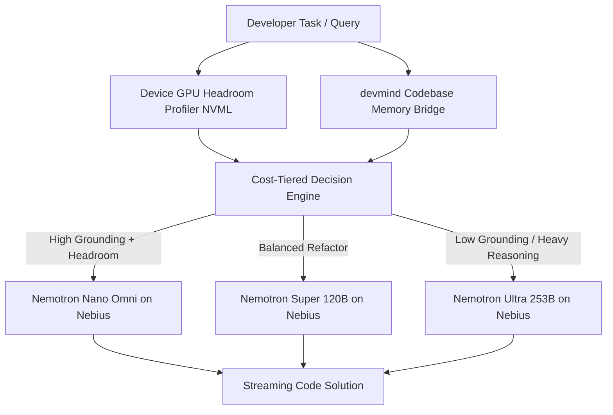

# Just-Enough-AI ⚡

> **Memory-aware, hardware-headroom cost-tiered agentic coding harness.**  
> Built for the **Nebius x NVIDIA Global AI Hackathon** (Coding & Agentic Engineering Track).

---

## 🎯 What is Just-Enough-AI?

Modern AI coding agents burn through frontier model tokens (and dollars) on every keystroke, regardless of task complexity or local compute availability. 

**Just-Enough-AI** introduces a hardware- and memory-aware routing harness that routes developer tasks across **NVIDIA Nemotron tiers** on **Nebius Token Factory**:
* **Nemotron Nano (Omni):** Lightning-fast, cost-efficient model ($0.15 / 1M blended tokens). Assigned when local GPU headroom is available and persistent codebase memory from **devmind** provides high grounding confidence.
* **Nemotron Super (120B):** Balanced multi-file reasoning model ($0.375 / 1M blended tokens) for moderate complexity refactoring.
* **Nemotron Ultra (253B):** Frontier model ($1.80 / 1M blended tokens) reserved for ungrounded, high-complexity architectural tasks or constrained local devices.

---

## 🏗️ Architecture



---

## 🚀 Quickstart & Setup

This repository is managed with [uv](https://github.com/astral-sh/uv).

### 1. Clone & Setup
```bash
git clone https://github.com/Anishp-cell/Just-Enough-AI.git
cd Just-Enough-AI
```

### 2. Virtual Environment & Dependencies
A dedicated virtual environment has been created at `.venv`. To install dependencies:

```bash
# Using uv (recommended)
uv pip install -r requirements.txt

# Or install in editable mode with dev tools
uv pip install -e ".[dev]"
```

### 3. Configure Environment Variables
Copy `.env.example` to `.env` and provide your Nebius Token Factory API key:
```bash
cp .env.example .env
```
*(Note: If `NEBIUS_API_KEY` is not set or `MOCK_MODE=true`, the system runs in local simulated mock mode for instant testing without token costs).*

---

## 💻 CLI Commands

Run the CLI using `uv run` or directly with the virtual environment activated:

```bash
# Show version
uv run jeai version

# Inspect local NVIDIA GPU VRAM headroom
uv run jeai profile

# View Nebius Token Factory Nemotron pricing tiers
uv run jeai pricing

# Evaluate a task routing decision without burning tokens
uv run jeai route "Add a helper function to format currency in utils.py"

# Route and execute a coding task
uv run jeai run "Refactor the payment webhook handler to support idempotent retries"
```

---

## 📊 Benchmarking & Cost Efficiency

| Tier | Model ID | Cost / 1M Tokens (Blended) | Target Scenario | Cost Reduction vs. Ultra |
| :--- | :--- | :---: | :--- | :---: |
| **Nano** | `nvidia/nemotron-3-nano-omni` | **$0.15** | Grounded tasks + Local GPU headroom | **91.6% Savings** |
| **Super** | `nvidia/nemotron-3-super-120b-a12b` | **$0.375** | Moderate refactoring & features | **79.2% Savings** |
| **Ultra** | `nvidia/Llama-3_1-Nemotron-Ultra-253B-v1` | **$1.80** | Ungrounded, high-complexity tasks | Baseline |

---

## 🏛️ Prior Art Acknowledgments
* **NVIDIA Switchyard:** Explores task-complexity routing for Nemotron models (pre-alpha, Rust-based). Just-Enough-AI differentiates by introducing device VRAM headroom detection and external persistent codebase memory.
* **Aider:** Demonstrates static architect/editor model splits. Just-Enough-AI introduces dynamic, multi-factor hardware- and memory-informed routing across Nebius Token Factory tiers.
* **devmind:** Open-source persistent codebase memory CLI providing the semantic retrieval foundation.

---

## 📄 License
Apache-2.0 License.
