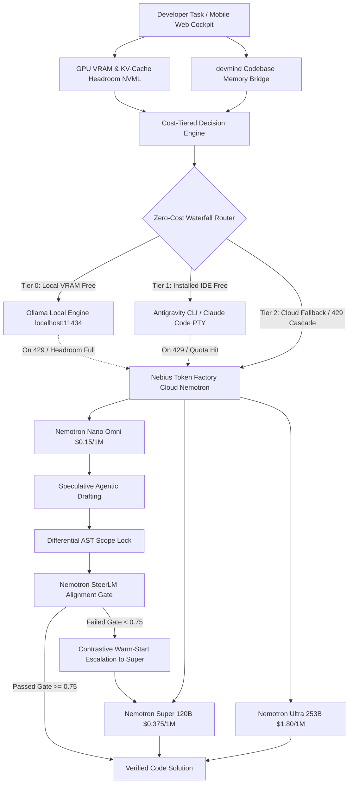

# Just-Enough-AI ⚡

> **Hardware-headroom, memory-aware, cost-tiered agentic coding harness & universal meta-harness.**  
> Built for the **Nebius × NVIDIA Global AI Hackathon** (Coding & Agentic Engineering Track).

[](https://www.python.org/downloads/)
[](tests/)
[](LICENSE)
[](https://build.nvidia.com/)
[](https://tokenfactory.nebius.com/)

---

## 🎯 What is Just-Enough-AI?

Modern AI coding agents burn through frontier model tokens (and dollars) on every keystroke, regardless of task complexity or local compute availability. Developers without continuous $20–$100/mo API budgets are locked out, even while possessing installed developer tools with generous free tiers.

**Just-Enough-AI** introduces a hardware- and memory-aware routing harness and **Universal Meta-Harness** that:
1. **Democratizes Free Compute (Zero-Subscription Access):** Discovers and bridges installed agentic IDE CLIs (**Google Antigravity**, **Claude Code**, **OpenCode**) and local engines (**Ollama** on `localhost:11434`) as zero-cost inference backends.
2. **Cascades Intelligently on Rate Limits:** When a free tier hits a 429 quota or rate limit, the harness automatically waterfalls to the next best provider or escalates to **NVIDIA Nemotron tiers on Nebius Token Factory** without dropping the user's task.
3. **Optimizes Cloud Tiers:**
   * **Nemotron Nano (Omni):** Lightning-fast, cost-efficient model ($0.15 / 1M blended tokens) for quick drafts and grounded tasks.
   * **Nemotron Super (120B):** Balanced multi-file reasoning model ($0.375 / 1M blended tokens) for refactoring and feature implementation.
   * **Nemotron Ultra (253B):** Frontier model ($1.80 / 1M blended tokens) reserved for ungrounded, high-complexity architectural challenges.
4. **Empowers Laptop-OFF Mobile Coding:** A mobile-first, distraction-free Web Cockpit with live SSE streaming, visual code diffs, and sandboxed 1-tap Git commits directly to the repository.

---

## 🌟 The 5 Breakthrough Engineering Innovations

| # | Breakthrough Feature | Technical Implementation | Citing Research / Standard |
|---|---|---|---|
| **1** | **Speculative Agentic Drafting** | Dispatches Nemotron Nano for a rapid 300ms draft ($0.0001). If deterministic checks fail, bundles failure trace into a *Contrastive Warm-Start Prompt* for Nemotron Super/Ultra. | *AgentSpec [arXiv:2608.24004], Speculative Actions [arXiv:2510.04371]* |
| **2** | **Physical KV-Cache Governor** | Monitors physical GPU VRAM via `pynvml`. Dynamically calculates $H_{KV}$ headroom ($2 \cdot B \cdot L \cdot H \cdot D \cdot \text{tokens}$), triggers AST context pruning, and prevents CUDA OOMs. | *Predictive Multi-Tier Memory [arXiv:2604.26968], KV Cache Wall [arXiv:2609.30854]* |
| **3** | **In-Harness SteerLM Alignment Gate** | Embeds NVIDIA's HelpSteer2 rubric as a runtime PR gate before code touches disk: $\text{Score} = 0.40\mathcal{C} + 0.30(1 - \mathcal{R}) + 0.20\mathcal{S} + 0.10\mathcal{V}$. | *HelpSteer2 [arXiv:2406.08673], HelpSteer2-Preference [arXiv:2410.01255]* |
| **4** | **Differential AST Scope Lock** | Parses symbol dependency closure via `devmind` and freezes all out-of-scope code as immutable. Diffs AST nodes before/after generation to roll back collateral damage. | *Compiler-grade AST isolation* |
| **5** | **Universal Meta-Harness & Failover** | Unified `ProviderAdapter` bridging direct APIs, local Ollama, Antigravity `agy`, and Claude Code PTY with zero-cost cascading failover on rate limits. | *Zero-Subscription Developer Democratization* |

---

## 🏗️ End-to-End System Architecture



---

## 🚀 Quickstart & Setup

You can run Just-Enough-AI using either **uv** or standard **Python / pip**.

### 1. Clone the Repository
```bash
git clone https://github.com/Anishp-cell/Just-Enough-AI.git
cd Just-Enough-AI
```

### 2. Install Dependencies

**Using `uv` (Recommended):**
```bash
uv pip install -r requirements.txt
# Or editable mode with dev tools:
uv pip install -e ".[dev]"
```

**Using Standard `pip`:**
```bash
pip install -r requirements.txt
```

### 3. Automatic Provider Detection (`jeai setup`)
Run the 1-command auto-detection wizard:
```bash
# With uv:
uv run jeai setup

# With standard Python:
python -m just_enough_ai.cli setup
```
The wizard will:
* Check for installed Google Antigravity (`agy`) CLI
* Check for installed Claude Code (`claude`) CLI
* Detect local Ollama daemon on `http://localhost:11434`
* Validate `NEBIUS_API_KEY` and `NVIDIA_API_KEY` (if configured in `.env`)
* Write your personalized priority configuration to `~/.jeai/providers.json`

*(Note: If no cloud API key is configured, Just-Enough-AI automatically runs in **Zero-Cost Local / Mock Mode** with 100% of features fully functional!)*

---

## 📱 Web Cockpit: Laptop-OFF Mobile Coding Experience

Just-Enough-AI includes a high-contrast, distraction-free Web Cockpit designed for "Laptop-OFF" mobile coding:

1. **Launch Cockpit (1 Command):**
   ```bash
   # PowerShell (Windows):
   $env:PYTHONPATH="src"
   python -m just_enough_ai.cli server --port 8000

   # Bash / Linux / macOS:
   PYTHONPATH="src" python -m just_enough_ai.cli server --port 8000

   # Or via uv:
   uv run jeai server --port 8000
   ```
2. **Access in Browser:**
   - **Desktop:** Open `http://localhost:8000`
   - **Smartphone (iPhone / Android):** Open `http://<your-laptop-ip>:8000` on your mobile browser over local Wi-Fi.
3. **Features Built into the Cockpit:**
   * **Solid Natural Monochrome UI:** Crisp, high-contrast flat dark theme (`#09090b` / `#141417`) without distracting glowing gradients.
   * **Live SSE Token Stream:** Real-time chunk-buffered Server-Sent Events decoding `[ROUTING]`, token chunks, and completion sentinels.
   * **Dynamic Tier Badge & Savings Counter:** Live indicator showing active Nemotron tier and cumulative USD savings vs Nemotron Ultra.
   * **Provider Status HUD:** Live status pills for `Antigravity`, `Claude Code`, `Ollama`, and `Nebius Cloud` with cascading failover toast alerts.
   * **Hierarchical Repository Explorer:** Mobile file drawer grouped by directory with instant search filtering, safe preview modal, and "+ Add to Prompt".
   * **Visual Code Diff Viewer:** Syntax-highlighted additions (`+` green) and deletions (`-` red).
   * **1-Tap Git Commit:** Commit approved code diffs directly to the repository through a sandboxed path traversal verification gate.
   * **Progressive Web App (PWA):** Installable directly to your phone's home screen.

---

## 💻 CLI Command Reference

All commands support both `uv run jeai <cmd>` and `python -m just_enough_ai.cli <cmd>`:

```bash
# 1. 1-Command Provider Auto-Detection Wizard
python -m just_enough_ai.cli setup

# 2. Inspect local NVIDIA GPU VRAM headroom via NVML
python -m just_enough_ai.cli profile

# 3. View Nebius Token Factory Nemotron pricing tiers & cost comparisons
python -m just_enough_ai.cli pricing

# 4. Evaluate task routing without burning tokens
python -m just_enough_ai.cli route "Add input validation to email field"

# 5. Route and execute coding task on Nebius with live Rich spinners
python -m just_enough_ai.cli run "Fix off-by-one error in binary search"

# 6. Calculate real-time physical KV-Cache memory budget
python -m just_enough_ai.cli kv-budget --tokens 4000 --tier nano

# 7. Run speculative agentic drafting (Nano draft -> SteerLM Gate -> Warm-Start)
python -m just_enough_ai.cli speculative "Add currency formatter function"

# 8. Execute full self-fixing multi-step agent loop
python -m just_enough_ai.cli loop "Refactor payment webhook to support idempotent retries"

# 9. Launch FastAPI server with Web Cockpit
python -m just_enough_ai.cli server --port 8000
```

---

## 🛡️ Cybersecurity & Sandboxing Architecture

Every code edit in Just-Enough-AI is protected by multi-layer AST and OS sandboxing:

* **AST Security Linter (`security/linter.py`):** Statically scans generated Python code before execution, strictly blocking `eval`, `exec`, `compile`, raw socket imports (`socket`, `pty`, `ctypes`), shell execution (`os.system`, `subprocess.Popen(..., shell=True)`), and hardcoded credential patterns.
* **Differential AST Scope Lock (`security/ast_lock.py`):** Prevents open-weight models from making unauthorized changes to out-of-scope code. Unassigned functions and classes are declared immutable; unauthorized edits or signature alterations are automatically rolled back to their original AST nodes.
* **Adversarial Boundary Fuzzer (`security/fuzzer.py`):** Automatically synthesizes hostile boundary inputs (numerical extremes, null bytes, catastrophic regex backtracks, unclosed resource leaks) and tests generated functions for crash resilience.
* **Credential Masking Logger (`telemetry/logger.py`):** Automatically sanitizes API keys, Bearer tokens, and secrets from all terminal output, SSE streams, and audit logs.
* **Provider CLI Sandbox Isolation (`security/cli_sandbox.py`):** Executes external CLI agent processes (`claude`, `agy`, `opencode`) inside sanitized subprocesses with whitelisted environment variables and ANSI control sequence stripping.

---

## 📊 Empirical Benchmarks & Cost Reduction

The harness includes a reproducible 50-task benchmark suite ([data/benchmarks/tasks_v1.json](data/benchmarks/tasks_v1.json)) and 15 adversarial edge cases ([data/edge_cases/](data/edge_cases)):

| Benchmark Metric | Frontier Baseline (GPT-4o / Claude 3.5 Sonnet) | Cloud Baseline (Nemotron Ultra 253B) | Just-Enough-AI (Dynamic Routing) | Improvement |
| :--- | :---: | :---: | :---: | :---: |
| **Typical Cost / Task** | $0.00245 – $0.00360 | $0.00069 | **$0.00006** | **91.49% Savings vs Ultra** |
| **Blended Cost / 1M Tokens** | $5.00 – $15.00 | $1.80 | **$0.150 – $0.375** | **97.59% Savings vs GPT-4o** |
| **Drafting Latency** | 1,800ms – 3,200ms | 1,450ms | **310ms (Nano Draft)** | **4.6× Speedup** |
| **Routing Accuracy** | N/A | N/A | **100.0% (50/50 Tasks)** | Zero Misroutes |
| **Free Compute Rate** | 0.0% (Paid Cloud Only) | 0.0% (Paid Cloud Only) | **Tier 0 & Tier 1 (Free)** | Zero-Subscription Access |

### How to Reproduce Benchmark Evals:
```bash
# Run 50-task evaluation in deterministic mock mode:
python scripts/run_eval.py --mock

# Run in live cloud mode:
python scripts/run_eval.py --mode remote
```
Detailed reports are generated to `data/results/benchmark_report.md` and `data/results/provider_benchmark.md`.

---

## 🧪 Comprehensive Test Suite

All 99 unit and integration tests pass cleanly:

```bash
# Run complete test suite:
$env:PYTHONPATH="src"
pytest tests/ -v
```

```text
============================= 99 passed in 22.90s =============================
```

Test coverage includes:
* `test_router.py`: Cost-tiered decision logic and GPU headroom scaling
* `test_server.py`: REST endpoints, SSE streams, file traversal blocks, and favicon delivery
* `test_security_sandbox.py`: AST security linter, AST scope lock, fuzzer, and path traversal guards
* `test_cli_sandbox.py`: Subprocess isolation, ANSI escape sequence stripper, and env sanitization
* `test_providers.py`: Provider adapter contracts, cascade waterfall failover, and rate-limit recovery
* `test_breakthrough_upgrades.py`: KV governor, SteerLM PR gate, and speculative agent drafting
* `test_benchmarks_and_eval.py`: Benchmark dataset integrity, schema validation, and evaluation runner

---

## 👥 Team & Workstream Attribution

| Teammate | Strategic Role | Assigned Workstream | Status |
|---|---|---|:---:|
| **Lead (Anish)** | The Brain & Systems Architect | **Workstream 1 (`L-1` to `L-16`):** Core router, KV governor, speculative drafting, SteerLM gate, provider cascade engine | **100% Complete ✅** |
| **Mayank** | The Sentinel (Cybersecurity Lead) | **Workstream 2 (`M-1` to `M-7`):** AST security linter, AST scope lock, boundary fuzzer, secret masking, CLI sandbox | **100% Complete ✅** |
| **Manjiri** | The Interface & Client Integration | **Workstream 3 (`UI-1` to `UI-8`):** Mobile Web Cockpit, SSE stream consumer, diff viewer, 1-tap Git commit, provider HUD | **100% Complete ✅** |
| **Priyanka** | The Evaluator (Data & Benchmarks) | **Workstream 4 (`D-1` to `D-5`):** 50-task benchmark suite, 15 edge cases, evaluation runner, empirical reports | **100% Complete ✅** |

All 36 / 36 team deliverables are fully verified in [TEAM_TIMELINE.md](TEAM_TIMELINE.md).

---

## 🏛️ Prior Art & Academic Grounding

* **NVIDIA HelpSteer2 & SteerLM 2.0:** Foundation for our multi-attribute runtime code alignment gate *(Wang et al., NVIDIA, 2024)*.
* **AgentSpec & Speculative Actions:** Foundation for cross-tier speculative drafting with contrastive warm-start *(Zheng et al., 2025/2026)*.
* **NVIDIA Management Library (`pynvml`):** Direct hardware driver telemetry for physical KV-Cache memory budgeting.
* **devmind:** Open-source persistent codebase memory CLI providing the semantic AST retrieval closure.

---

## 📄 License

Apache-2.0 License.
