# Just-Enough-AI — Master Engineering Roadmap

**Hackathon:** Nebius × NVIDIA Global AI Hackathon (Coding & Agentic Engineering Track)  
**Project:** `Just-Enough-AI` (`jeai`) — Hardware-Headroom & Memory-Aware Cost-Tiered Agentic Coding Harness  
**Primary UI Target:** Responsive Mobile-First Web Application (Code from your smartphone with your laptop **completely powered off**) + Typer CLI for local developers.  
**Secondary UI Target (End Phase):** Electron desktop application bundle (packaged at the very end).

---

## 1. The Core Differentiators

### A. The "Antigravity Buster" (Laptop-OFF Mobile Coding)
> **Why existing tools fail on mobile:**  
> Tools like **Google Antigravity**, **Cursor**, and **VS Code Remote** require your primary laptop/desktop computer to be powered ON, awake, and running an agent daemon locally. If your laptop is shut in your backpack, out of battery, or powered off, **you cannot code from your phone.** Furthermore, mobile views rarely allow you to properly browse repository files, view diffs, or supervise agent execution.

**How Just-Enough-AI Solves This:**
1. **Nebius Cloud-Native Inference:** All models (NVIDIA Nemotron Nano, Super, Ultra) run on Nebius Token Factory's cloud GPUs. Zero local GPU is required when operating remotely.
2. **Laptop-OFF Cloud Coding:** A lightweight headless backend (deployable on a free cloud instance or Nebius VM) syncs with GitHub. 
3. **Mobile-First Web Cockpit:** You pull out your phone anywhere, browse the repo file tree, inspect code, prompt the Nemotron agent, review real-time streaming diffs, and approve git commits — **while your laptop is 100% switched off at home.**
4. **Adaptive Cost-Tiering on the Go:** The router knows you are in "Cloud/Remote Mode", assesses the codebase memory context (devmind/index), and automatically picks the cheapest viable Nemotron tier (saving 70–90% vs frontier flat-rate models).

---

### B. The 4 Breakthrough Upgrades NO CURRENT HARNESS HAS

While other frameworks rely on standard JSON error catches and basic retries, Just-Enough-AI introduces four fundamental innovations combining NVIDIA hardware physics, Nemotron alignment research, and compiler safety:

1. **Speculative Agentic Drafting across Nemotron Tiers (`agent/speculative.py`):**  
   Brings NVIDIA's signature inference acceleration concept (*Speculative Decoding*) to the multi-agent scaffold level. Dispatches Nemotron 3 Nano Omni for an instant ~300ms draft ($0.0001). If deterministic AST verification fails, Nano's draft is converted into a **Contrastive Warm-Start Artifact** for Nemotron Super/Ultra, allowing the large model to solve the problem in 1 turn without exploratory token burn. *(Citing AgentSpec [arXiv:2608.24004], Speculative Actions [arXiv:2510.04371]).*

2. **Hardware-Headroom KV-Cache Governor (`profiler/kv_governor.py`):**  
   Connects the agent loop directly to physical GPU memory via `pynvml`. Dynamically calculates the physical KV-Cache memory footprint ($2 \times B \times L \times H \times D \times \text{tokens}$) and budgets agent steps against physical VRAM headroom. Automatically triggers semantic AST KV-pruning and elastic cloud handoff before VRAM thrashing or CUDA OOM occurs. *(Citing Predictive Multi-Tier Memory Management [arXiv:2604.26968], SoK: The KV Cache Is the New Memory Wall [arXiv:2609.30854]).*

3. **In-Harness Nemotron SteerLM Multi-Attribute Verifier (`agent/steer_critic.py`):**  
   Embeds NVIDIA's state-of-the-art alignment research (**HelpSteer2 / SteerLM 2.0**) directly into the runtime agent loop as an active PR gate. Scores candidate patches across Correctness, Regression Risk, Security, and Verbosity before allowing code to touch the filesystem. *(Citing HelpSteer2 [arXiv:2406.08673], HelpSteer2-Preference [arXiv:2410.01255]).*

4. **Differential AST Scope Lock (`security/ast_lock.py`):**  
   Enforces compiler-grade blast-radius containment. Derives the symbol dependency closure via `devmind` and locks all out-of-scope code as immutable. Diffs AST nodes before and after generation, surgically rolling back any unauthorized mutations to adjacent functions.

5. **Universal Meta-Harness & Multi-Provider Adapter Bridge (`providers/`):**  
   Turns installed free-tier agentic environments (Google Antigravity `agy`, Claude Code CLI, OpenCode, Codex, and local Ollama) into swappable, headless inference backends alongside direct NVIDIA NIM / Nebius Token Factory APIs. Features an automated zero-cost cascading failover waterfall: tries free local/installed backends first, and elastically cascades to cloud Nemotron only when local headroom or free quotas expire.

---

### C. The Universal Meta-Harness: Zero-Subscription Access Democratization
> **The Problem with "Frontier-Only" Agents:**  
> Most modern coding harnesses demand $20–$100/month in OpenAI, Anthropic, or cloud API tokens. Developers, students, and open-source contributors without paid API keys are locked out. Simultaneously, developers already have agentic IDEs installed on their machines (Google Antigravity, Claude Code, OpenCode, Ollama) which provide generous free tiers or local inference—but these tools operate in closed client silos and do not expose raw API keys for custom workflows.

**How Just-Enough-AI Solves This:**
1. **Unified Provider Abstraction (`ProviderAdapter`):** Normalizes model execution across direct REST APIs, local HTTP engines (Ollama on localhost:11434), and headless CLI process execution (`agy`, `claude`, `opencode`).
2. **Zero-Cost Waterfall Router:** Evaluates tasks through a three-tier cost cascade:
   - **Tier 0 (Free Local):** Ollama running local Nemotron-Nano / Qwen / Llama weights with hardware NVML governance.
   - **Tier 1 (Free Agentic IDEs):** Headless execution through installed tools (Antigravity CLI, Claude Code CLI, OpenCode) with automatic ANSI sanitization and permission handling.
   - **Tier 2 (Cloud Fallback):** Nebius Token Factory / NVIDIA NIM running Nemotron Nano ($0.15/1M), Super ($0.375/1M), or Ultra ($1.80/1M).
3. **Cascading Failover on Rate Limits:** If a free-tier provider triggers a rate-limit (HTTP 429 or quota exhaustion), the harness instantly waterfalls to the next best provider without halting or failing the developer's multi-step task.
4. **`jeai setup` Auto-Detection Wizard:** Scans the developer's machine on first boot (`which agy`, `which claude`, `which ollama`, etc.), automatically registers detected tools, and benchmarks their availability in under 5 seconds.

---

## 2. Team Division & Ownership (4 Members)

To ensure maximum velocity and zero architectural bottlenecks, tasks are strictly partitioned by core competency:

| Member | Strategic Role | Primary Responsibility | Critical Deliverables |
|---|---|---|---|
| **Lead (You)** | **The Brain & Systems Architect** | Overall architecture, routing matrix, agent execution loop, Nebius runner, devmind memory bridge, speculative drafting, KV governor, **Universal Provider Adapters** (Ollama, Antigravity, Claude Code), **Cascading Failover Engine**, and backend API. | `router/`, `agent/`, `bridge/`, `profiler/`, `providers/` (`base.py`, `nebius.py`, `antigravity.py`, `claude_code.py`, `ollama.py`, `cascade.py`), `models.py`, `config.py`, FastAPI backend |
| **Mayank** | **The Sentinel (Cybersec Lead)** | Execution safety, adversarial fuzzing, process sandbox, AST scope lock, security invariants, **provider CLI sandbox isolation**, **ANSI terminal sanitization**, and credential protection. | Adversarial fuzzer (TG 3), subprocess sandbox, AST security linter, AST scope lock (`ast_lock.py`), secret masking, provider CLI sandbox (`security/cli_sandbox.py`) |
| **Manjiri** | **The Interface (UI/UX & Client Integration Lead)** | Mobile-first responsive web cockpit, client-side backend integration (SSE streaming & REST API client layer), repository file viewer, streaming diff visualizer, CLI polish, **`jeai setup` auto-detection wizard**, and **Provider Status HUD**. | Mobile web app (Vite + CSS/Tailwind + SSE streaming), API client integration, Rich CLI, diff viewer, cost widget, `jeai setup` wizard, Web Cockpit Provider HUD |
| **Data Teammate** | **The Evaluator (Data & Evals Lead)** | Benchmark datasets, cost savings data analysis, test prompt curation, fuzzing test cases, **multi-provider latency & failover resilience benchmarks**, Switchyard comparison tables. | 50–100 task benchmark suite, CSV/JSON cost tracking data, edge-case corpus, eval charts for README, multi-provider benchmark report |

---

## 3. Architecture Snapshot

```
src/just_enough_ai/
├── cli.py                 ← Typer CLI for local/headless devs (Manjiri + Lead)
├── config.py              ← Pydantic settings & environment validation (Lead)
├── models.py              ← Core schemas: ModelTier, Headroom, RoutingDecision (Lead)
├── server.py              ← FastAPI backend with SSE streaming for Web/Mobile (Lead + Manjiri)
├── agent/
│   ├── runner.py          ← Nebius Token Factory live streaming runner (Lead)
│   ├── loop.py            ← Multi-step agentic tool-calling loop with json-repair (Lead)
│   ├── speculative.py     ← [Breakthrough #1] Speculative Agentic Drafting across Tiers (Lead)
│   ├── steer_critic.py    ← [Breakthrough #3] Nemotron HelpSteer2 Alignment PR Gate (Lead)
│   ├── mock.py            ← Deterministic mock runner for offline testing (Data / QA)
│   └── sandbox.py         ← Isolated process execution jail & timeouts (Mayank)
├── bridge/
│   └── devmind.py         ← Codebase memory indexing & AST symbol closure (Lead)
├── profiler/
│   ├── gpu.py             ← NVIDIA GPU VRAM detection via pynvml (Lead)
│   ├── kv_governor.py     ← [Breakthrough #2] Real-time KV-Cache Headroom & Tree Pruner (Lead)
│   └── system.py          ← System RAM & environment profiler (Lead)
├── providers/             ← [Breakthrough #5] Universal Meta-Harness & Multi-Provider Bridge
│   ├── base.py            ← Abstract ProviderAdapter interface (Lead)
│   ├── registry.py        ← Provider registry & auto-discovery (Lead)
│   ├── nebius.py          ← NebiusDirectAdapter (NVIDIA Nemotron via API) (Lead)
│   ├── antigravity.py     ← AntigravityCliAdapter (agy CLI bridge) (Lead)
│   ├── claude_code.py     ← ClaudeCodePtyAdapter (Claude Code CLI bridge) (Lead)
│   ├── ollama.py          ← OllamaLocalAdapter (Local Ollama HTTP bridge) (Lead)
│   └── cascade.py         ← Zero-Cost Cascading Failover Router (Lead)
├── router/
│   ├── engine.py          ← 3-tier routing matrix (Local VRAM vs Remote Cloud) (Lead)
│   └── cost.py            ← Nebius Token Factory pricing tiers & savings math (Lead + Data)
├── security/
│   ├── ast_lock.py        ← [Breakthrough #4] Differential AST Scope Lock (Mayank + Lead)
│   ├── cli_sandbox.py     ← Provider CLI sandbox isolation & ANSI sanitizer (Mayank)
│   ├── fuzzer.py          ← Adversarial test synthesis & contract verification (Mayank)
│   └── linter.py          ← AST security invariants & credential leak scanner (Mayank)
└── telemetry/
    └── logger.py          ← Structured JSON event logging & audit trail (Mayank)

data/                      ← Managed by Data Teammate
├── benchmarks/            ← 50–100 curated coding tasks (easy, medium, complex)
├── edge_cases/            ← Hallucination & fuzzing test vectors for Mayank
└── results/               ← Cost & latency output logs vs. Switchyard / GPT-4
```

---

## 4. Phase-by-Phase Roadmap

---

### TG 0 — Baseline Setup & Tooling (Immediate)

**Goal:** Clean working baseline, dependency fixes, automated CI, and benchmark data structure.

| Member | Specific Task | Files Involved |
|---|---|---|
| **Lead** | Fix `profiler/system.py` import chain, ensure pynvml & psutil load gracefully with fallback on machines without NVIDIA GPU. | [`profiler/system.py`](file:///d:/python/Nvidia%20Hackathon/src/just_enough_ai/profiler/system.py), [`profiler/gpu.py`](file:///d:/python/Nvidia%20Hackathon/src/just_enough_ai/profiler/gpu.py) |
| **Mayank** | Dependency security audit (`pip-audit`), verify `.env` secret isolation so API keys are never accidentally logged or committed. | [`requirements.txt`](file:///d:/python/Nvidia%20Hackathon/requirements.txt), `.gitignore` |
| **Manjiri** | Verify CLI runs cleanly on local machines (`jeai --help`), verify Rich console formatting. | [`cli.py`](file:///d:/python/Nvidia%20Hackathon/src/just_enough_ai/cli.py) |
| **Data Lead** | Set up `data/benchmarks/` and prepare initial JSON schema for coding tasks (prompt, expected files, difficulty tier). | `data/benchmarks/schema.json` |

---

### TG 1 — Core Routing, Streaming Runner & Mobile Web Foundation (Completed)

**Goal:** Live inference streaming from Nebius Token Factory, hardened routing logic, and a mobile-friendly web backend.

- ✅ **Lead:** Cloud-aware routing matrix, manual tier override, live Nebius streaming runner, token cost capture, FastAPI backend with SSE streaming.
- ⏳ **Mayank:** Subprocess sandbox stubs, path validation, secret masking.
- ⏳ **Manjiri:** Mobile-first web cockpit prototype, CLI polish.
- ✅ **Data Lead:** Starter benchmark task scaffold (`data/benchmarks/tasks_v1.json`).

---

### TG 2 — Memory Grounding & AST Symbol Indexer

**Goal:** Grounding via devmind bridge and mobile file exploration so users can view project files on their phone.

| Member | Specific Tasks |
|---|---|
| **Lead** | **devmind Memory Integration & Symbol Indexer**: AST symbol extractor and call-graph resolution. Calibrate confidence scores. Provide graceful fallback embedding. |
| **Mayank** | **Repository Path Validator**: Ensure file queries from the mobile interface or devmind bridge cannot access parent paths (`../`). |
| **Manjiri** | **Mobile Code Viewer**: Add a collapsible mobile file-tree explorer to the web cockpit. |
| **Data Lead** | **Grounding Evaluation**: Measure how confidence score shifts model routing from Ultra → Super → Nano. |

---

### TG 2.5 — Universal Meta-Harness & Multi-Provider Adapters (Zero-Cost Tier)

**Goal:** Turn installed free-tier agentic IDEs and local engines into unified, swappable inference backends with automatic cascading failover.

| Member | Specific Tasks |
|---|---|
| **Lead** | **Universal Provider Engine (`providers/`)**:<br>1. Define `ProviderAdapter` ABC (`base.py`, `registry.py`).<br>2. Build `NebiusDirectAdapter` (existing direct API) & `OllamaLocalAdapter` (local HTTP localhost:11434).<br>3. Build `AntigravityCliAdapter` (headless `agy` runner & artifact parser).<br>4. Build `ClaudeCodePtyAdapter` (PTY subprocess, `--dangerously-skip-permissions` automation).<br>5. Implement `CascadingFailoverRouter` (`providers/cascade.py`): on rate-limit 429/quota exhaustion, waterfall from Tier 0 (Ollama) → Tier 1 (Antigravity/Claude Code) → Tier 2 (Nebius Cloud). |
| **Mayank** | **Provider Process Sandbox & ANSI Stripper (`security/cli_sandbox.py`)**:<br>1. Execute spawned CLI adapters in sandboxed subprocess environments with isolated working directories.<br>2. Sanitize ANSI color escape codes and terminal cursor sequences from raw CLI outputs.<br>3. Prevent session token / environment credential bleeding across disparate CLI tools. |
| **Manjiri** | **`jeai setup` Wizard & Provider HUD (`cli.py`, `server.py`)**:<br>1. Implement interactive `jeai setup` CLI auto-detecting installed tools (`agy`, `claude`, `opencode`, `ollama`).<br>2. Add Provider Status Widget in Web Cockpit showing live status: `🟢 Antigravity (Free)`, `🟢 Claude Code (Free)`, `🟡 Ollama (Local)`, `🔵 Nebius (Cloud Fallback)`. |
| **Data Lead** | **Multi-Provider Latency & Resilience Benchmark (`data/results/providers.md`)**:<br>1. Benchmark prompt latency across Direct API vs CLI subprocesses.<br>2. Simulate rate-limit triggers (mock 429) to verify seamless zero-loss task cascade. |

---

### TG 3 — The Breakthrough Verification Layer ⭐

> [!IMPORTANT]
> **This is our premier hackathon differentiator.** Combines Speculative Drafting (Nano → Super), HelpSteer2 runtime validation, and Mayank's boundary fuzzer.

| Member | Specific Tasks |
|---|---|
| **Lead** | **Speculative Agentic Drafting (`agent/speculative.py`)** & **SteerLM Verifier (`agent/steer_critic.py`)**:<br>1. Dispatch 300ms Nemotron Nano draft.<br>2. On failure, bundle AST error into Contrastive Warm-Start Prompt for Nemotron Super/Ultra.<br>3. Run HelpSteer2 multi-attribute rubric (Correctness, Regression, Safety) as an in-line PR gate. |
| **Mayank** | **Adversarial Fuzzer & Contract Inference (`security/fuzzer.py`)**:<br>1. Parse function signatures, parameter types, and docstrings.<br>2. Synthesize hostile boundary inputs: `None`, huge integers, malformed JSON.<br>3. Feed crash traces to Lead's self-fix escalation loop. |
| **Manjiri** | **Verification Badge**: Display visual "Shield" in UI showing boundary tests synthesized and HelpSteer2 alignment score. |
| **Data Lead** | **Hallucination Eval Set**: 15 known "almost-right" code snippets to evaluate fuzzer and SteerLM catch rate. |

---

### TG 4 — Physical KV-Cache Governor & AST Scope Lock

**Goal:** Manage physical GPU memory via NVML and prevent out-of-scope model collateral damage.

| Member | Specific Tasks |
|---|---|
| **Lead** | **Hardware KV-Cache Governor (`profiler/kv_governor.py`)**: Calculate real-time $H_{KV}$ via `pynvml`. Prune noisy bash execution traces from context while preserving AST symbol declarations. Offload to Nebius cloud when local VRAM is full. |
| **Mayank** | **Differential AST Scope Lock (`security/ast_lock.py`)**: Freeze all AST symbols outside target dependency closure. Surgically strip and revert unauthorized mutations. |
| **Manjiri** | **Mobile Diff Reviewer**: Visual side-by-side or inline red/green diff preview on mobile screens with an "Approve & Commit" button. |
| **Data Lead** | **VRAM & Memory Benchmarking**: Measure token latency and memory footprint with KV governor active vs unconstrained loop. |

---

### TG 5 — Full "Laptop-OFF" Remote Cloud Deployment Experience

**Goal:** Package and demonstrate the cloud workflow so a user can close their laptop, walk away, and use Just-Enough-AI from their phone.

| Member | Specific Tasks |
|---|---|
| **Lead** | **GitHub Sync Integration**: Add webhook/git sync so that when tasks are approved on mobile, changes are committed and pushed directly to a remote GitHub branch. |
| **Manjiri** | **PWA (Progressive Web App) Support**: Add manifest and mobile touch gestures so the web app can be "Added to Home Screen" on iOS/Android. |
| **Mayank** | **Remote Auth & Session Security**: Add simple token-based access protection to the web cockpit. |
| **Data Lead** | **Remote vs. Local Performance Audit**: Measure latency of mobile requests over 4G/5G vs. local execution. |

---

### TG 6 — Benchmark Suite, Cost Analysis & Switchyard Comparison

**Goal:** Provide the quantitative data proof that wins hackathons.

| Member | Specific Tasks |
|---|---|
| **Data Lead** | **Benchmark Execution & Cost Audit**:<br>1. Run the full 50-task suite across all tiers.<br>2. Calculate total token spend, average latency, and cost savings vs. standard flat-rate models (74%+ savings target).<br>3. Generate formatted markdown tables, charts, and summary graphics for README. |
| **Lead** | Support benchmark runner script with automated metrics extraction. |
| **Mayank** | Verify benchmark runner does not leak test harness credentials or blow API rate limits. |
| **Manjiri** | Embed cumulative savings widget into web UI ("You have saved $X.XX across Y tasks"). |

---

### TG 7 — Desktop Packaging, Video Demo & Final Submission Polish

**Goal:** Package the Electron desktop app, record the demo video, and submit.

| Member | Specific Tasks |
|---|---|
| **Manjiri** | **Electron Packaging**: Wrap web frontend into Electron shell via `electron-builder` for native Windows installer (`.exe`). |
| **Lead** | Final code review, edge case hardening, README architecture diagrams. |
| **Mayank** | Final security review, mock mode validation for judges without Nebius keys. |
| **Data Lead** | Slides & presentation data points; ensure all benchmark claims are backed by data. |
| **All Team** | **3-Minute Demo Video Recording**:<br>- 0:00–0:45: The Problem & NVML Telemetry Dashboard.<br>- 0:45–1:45: Speculative Agent Drafting in action (Nano 300ms draft → Super escalation).<br>- 1:45–2:30: Differential AST Scope Lock & HelpSteer2 runtime gate.<br>- 2:30–3:00: Cost savings benchmark results and open architecture summary. |

---

## 5. Dependency Graph

```mermaid
graph TD
    TG0["TG 0: Baseline & Tooling<br/>(All 4 Members)"]
    
    TG1_Lead["TG 1: Cloud Router & Nebius Streaming<br/>(Lead) [DONE]"]
    TG1_Mayank["TG 1: Subprocess Sandbox<br/>(Mayank)"]
    TG1_Manjiri["TG 1: Mobile Web UI Foundation<br/>(Manjiri)"]
    TG1_Data["TG 1: 25-Task Benchmark Dataset<br/>(Data Lead) [DONE]"]
    
    TG2["TG 2: devmind Grounding & AST Indexer<br/>(Lead + Manjiri)"]
    TG2_5["TG 2.5: Universal Meta-Harness & Adapters<br/>(Lead + Mayank + Manjiri)"]
    
    TG3["TG 3: Speculative Drafting & HelpSteer2 Gate ⭐<br/>(Lead + Mayank)"]
    
    TG4["TG 4: KV-Cache Governor & AST Scope Lock<br/>(Lead + Mayank + Manjiri)"]
    
    TG5["TG 5: Laptop-OFF Cloud Remote Experience<br/>(Lead + Manjiri)"]
    
    TG6["TG 6: Benchmark Proof & Cost Data<br/>(Data Lead)"]
    
    TG7["TG 7: Electron Desktop App & Demo Video<br/>(Manjiri + All)"]

    TG0 --> TG1_Lead
    TG0 --> TG1_Mayank
    TG0 --> TG1_Manjiri
    TG0 --> TG1_Data
    
    TG1_Lead --> TG2
    TG1_Manjiri --> TG2
    TG2 --> TG2_5
    TG1_Mayank --> TG2_5
    TG2_5 --> TG3
    TG1_Mayank --> TG3
    
    TG3 --> TG4
    TG4 --> TG5
    TG1_Data --> TG6
    TG2_5 --> TG6
    TG3 --> TG6
    TG5 --> TG6
    
    TG5 --> TG7
    TG6 --> TG7

    style TG2_5 fill:#2c3e50,stroke:#e67e22,stroke-width:2px
    style TG3 fill:#1b4d3e,stroke:#2ecc71,stroke-width:3px
    style TG4 fill:#1c3d5a,stroke:#3490dc,stroke-width:2px
    style TG7 fill:#3d2c4d,stroke:#9b59b6,stroke-width:2px
```



---

## 6. Hackathon Compliance Checklist

- [x] **NVIDIA Open-Source Models:** Uses Nemotron-3 Nano, Super-120B, and Ultra-253B.
- [x] **Nebius Infrastructure:** Calls Nebius Token Factory via OpenAI-compatible API on high-performance GPUs.
- [x] **Track Fit:** Directly addresses *Coding and Agentic Engineering* track.
- [x] **Hardware Grounding:** Uses NVIDIA Management Library (`pynvml`) for physical VRAM and KV-Cache headroom telemetry.
- [x] **NVIDIA Alignment Integration:** Leverages NVIDIA's HelpSteer2 / SteerLM multi-attribute rubric as a runtime PR gate.
- [x] **Zero-Cost Access Democratization:** Functions out-of-the-box with zero paid API keys by orchestrating local Ollama and installed developer IDE free-tiers with seamless cloud escalation.
- [x] **Open Infrastructure:** Zero dependency on closed proprietary big-tech agent clouds.