# Just-Enough-AI — Master Engineering Roadmap

**Hackathon:** Nebius × NVIDIA Global AI Hackathon (Coding & Agentic Engineering Track)  
**Project:** `Just-Enough-AI` (`jeai`) — Hardware-Headroom & Memory-Aware Cost-Tiered Agentic Coding Harness  
**Primary UI Target:** Responsive Mobile-First Web Application (Code from your smartphone with your laptop **completely powered off**) + Typer CLI for local developers.  
**Secondary UI Target (End Phase):** Electron desktop application bundle (packaged at the very end).

---

## 1. The Core Differentiator: "The Antigravity Buster"

> **Why existing tools fail on mobile:**  
> Tools like **Google Antigravity**, **Cursor**, and **VS Code Remote** require your primary laptop/desktop computer to be powered ON, awake, and running an agent daemon locally. If your laptop is shut in your backpack, out of battery, or powered off, **you cannot code from your phone.** Furthermore, mobile views rarely allow you to properly browse repository files, view diffs, or supervise agent execution.

**How Just-Enough-AI Solves This:**
1. **Nebius Cloud-Native Inference:** All models (NVIDIA Nemotron Nano, Super, Ultra) run on Nebius Token Factory's cloud GPUs. Zero local GPU is required when operating remotely.
2. **Laptop-OFF Cloud Coding:** A lightweight headless backend (deployable on a free cloud instance or Nebius VM) syncs with GitHub. 
3. **Mobile-First Web Cockpit:** You pull out your phone anywhere, browse the repo file tree, inspect code, prompt the Nemotron agent, review real-time streaming diffs, and approve git commits — **while your laptop is 100% switched off at home.**
4. **Adaptive Cost-Tiering on the Go:** The router knows you are in "Cloud/Remote Mode", assesses the codebase memory context (devmind/index), and automatically picks the cheapest viable Nemotron tier (saving 70–90% vs frontier flat-rate models).

---

## 2. Team Division & Ownership (4 Members)

To ensure maximum velocity and zero architectural bottlenecks, tasks are strictly partitioned by core competency:

| Member | Strategic Role | Primary Responsibility | Critical Deliverables |
|---|---|---|---|
| **Lead (You)** | **The Brain & Systems Architect** | Overall architecture, routing matrix, agent execution loop, Nebius OpenAI runner, devmind memory bridge, and backend API. | `router/`, `agent/`, `bridge/`, `profiler/`, `models.py`, `config.py`, FastAPI backend |
| **Mayank** | **The Sentinel (Cybersec Lead)** | Execution safety, adversarial fuzzing, process sandbox, AST invariant validation, and token/credential security. | Adversarial fuzzer (TG 3), subprocess execution sandbox, AST security linter, secret leak prevention |
| **Manjiri** | **The Interface (UI/UX & Client Integration Lead)** | Mobile-first responsive web cockpit, client-side backend integration (SSE streaming & REST API client layer), repository file viewer, streaming diff visualizer, CLI polish. | Mobile web app (Vite + CSS/Tailwind + SSE streaming), API client integration, Rich CLI, diff viewer, cost widget |
| **Data Teammate** | **The Evaluator (Data & Evals Lead)** | Benchmark datasets, cost savings data analysis, test prompt curation, fuzzing test cases, Switchyard comparison tables. | 50–100 task benchmark suite, CSV/JSON cost tracking data, edge-case corpus, eval charts for README |

> **Leadership Note on Data Teammate:**  
> Her role is ring-fenced to data curation, benchmark execution, and metric analysis. This turns her into a high-value asset for hackathon judging (producing concrete cost/latency comparison proof) while ensuring she does not bottleneck core architectural or security code.

---

## 3. Architecture Snapshot

```
src/just_enough_ai/
├── cli.py             ← Typer CLI for local/headless devs (Manjiri + Lead)
├── config.py          ← Pydantic settings & environment validation (Lead)
├── models.py          ← Core schemas: ModelTier, Headroom, RoutingDecision (Lead)
├── server.py          ← FastAPI backend with SSE streaming for Web/Mobile (Lead + Manjiri)
├── agent/
│   ├── runner.py      ← Nebius Token Factory live streaming runner (Lead)
│   ├── loop.py        ← Multi-step agentic tool-calling loop (Lead)
│   ├── mock.py        ← Deterministic mock runner for offline testing (Data / QA)
│   └── sandbox.py     ← Isolated process execution jail & timeouts (Mayank)
├── bridge/
│   └── devmind.py     ← Codebase memory indexing & grounding retrieval (Lead)
├── profiler/
│   ├── gpu.py         ← NVIDIA GPU VRAM detection via pynvml (Lead)
│   └── system.py      ← System RAM & environment profiler (Lead)
├── router/
│   ├── engine.py      ← 3-tier routing matrix (Local VRAM vs Remote Cloud) (Lead)
│   └── cost.py        ← Nebius Token Factory pricing tiers & savings math (Lead + Data)
├── security/
│   ├── fuzzer.py      ← Adversarial test synthesis & contract verification (Mayank)
│   └── linter.py      ← AST security invariants & credential leak scanner (Mayank)
└── telemetry/
    └── logger.py      ← Structured JSON event logging & audit trail (Mayank)

data/                  ← Managed by Data Teammate
├── benchmarks/        ← 50–100 curated coding tasks (easy, medium, complex)
├── edge_cases/        ← Hallucination & fuzzing test vectors for Mayank
└── results/           ← Cost & latency output logs vs. Switchyard / GPT-4
```

---

## 4. Phase-by-Phase Roadmap

---

### TG 0 — Baseline Setup & Tooling (Immediate)

**Goal:** Clean working baseline, dependency fixes, automated CI, and benchmark data structure.

| Member | Specific Task | Files Involved |
|---|---|---|
| **Lead** | Fix `profiler/system.py` import chain, ensure pynvml & psutil load gracefully with fallback on machines without NVIDIA GPU. | [`profiler/system.py`](file:///d:/python/Nvidia%20Hackathon/src/just_enough_ai/profiler/system.py), [`profiler/gpu.py`](file:///d:/python/Nvidia%20Hackathon/src/just_enough_ai/profiler/gpu.py) |
| **Mayank** | Dependency security audit (`pip-audit`), verify `.env` secret isolation so API keys are never accidentally logged or committed. | [`requirements.txt`](file:///d:/python/Nvidia%20Hackathon/requirements.txt), `.gitignore` |
| **Manjiri** | Verify CLI runs cleanly on local machines (`jeai --help`), verify Rich console formatting. | [`cli.py`](file:///d:/python/Nvidia%20Hackathon/src/just_enough_ai/cli.py) |
| **Data Lead** | Set up `data/benchmarks/` and prepare initial JSON schema for coding tasks (prompt, expected files, difficulty tier). | `data/benchmarks/schema.json` |

**TG 0 Done Gate:**
- [ ] `pytest -q` runs and passes all baseline tests.
- [ ] `ruff check .` passes clean.
- [ ] `requirements.txt` has `psutil` and passes security audit.

---

### TG 1 — Core Routing, Streaming Runner & Mobile Web Foundation (Current Phase)

**Goal:** Live inference streaming from Nebius Token Factory, hardened routing logic, and a mobile-friendly web backend.

#### Lead (The Brain)
1. **Cloud vs. Local Routing Logic** ([`router/engine.py`](file:///d:/python/Nvidia%20Hackathon/src/just_enough_ai/router/engine.py)):
   - Add awareness for `ExecutionMode.LOCAL` vs `ExecutionMode.REMOTE_CLOUD`.
   - When running remotely (e.g. from phone), ignore local VRAM constraints and route purely based on task complexity + devmind memory confidence.
   - Support manual tier override (`--tier nano|super|ultra`).
2. **Live Nebius Streaming Runner** ([`agent/runner.py`](file:///d:/python/Nvidia%20Hackathon/src/just_enough_ai/agent/runner.py)):
   - Validate Nebius Token Factory base URL and model mappings (`nemotron-3-nano-omni`, `nemotron-3-super-120b`, `nemotron-ultra-253b`).
   - Extract real prompt/completion token usage from streaming response to compute exact USD cost.
3. **FastAPI Headless Server** (`src/just_enough_ai/server.py`):
   - Create endpoints: `GET /api/profile`, `POST /api/route`, `POST /api/run` (Server-Sent Events for real-time streaming to web/mobile).

#### Mayank (The Sentinel)
1. **Subprocess Execution Sandbox** (`src/just_enough_ai/agent/sandbox.py`):
   - Wrap tool executions and code runs in an isolated subprocess with strict timeout limits (e.g., 10s default).
   - Prevent path traversal: ensure the agent cannot write or read files outside the designated project root.
2. **Credential & Secret Masking** (`src/just_enough_ai/telemetry/logger.py`):
   - Intercept prompts and logs to strip or redact potential API keys, passwords, or tokens.

#### Manjiri (The Interface)
1. **Mobile-First Responsive Web UI Prototype**:
   - Build a lightweight web cockpit (HTML5/modern CSS or Vite) with a viewport optimized for mobile screens.
   - Screen 1: **Status & Model Badge** (Shows current active Nebius tier, cost meter).
   - Screen 2: **Task Input Bar** with quick buttons for common tasks (e.g., "Fix Bug", "Add Unit Test", "Explain Code").
   - Screen 3: **Live Streaming Output Pane** connected to `/api/run` via SSE.
2. **CLI Polish & Force Flags** ([`cli.py`](file:///d:/python/Nvidia%20Hackathon/src/just_enough_ai/cli.py)):
   - Add `--tier` flag and `--verbose` mode with Rich progress spinner.

#### Data Teammate (The Evaluator)
1. **Task Benchmark Dataset (Set 1)**:
   - Compile 25 distinct coding tasks:
     - 10 Simple (one-line bugfixes, docstring additions) → Target: Nano.
     - 10 Moderate (function refactors, test case generation) → Target: Super.
     - 5 Complex (cross-module architecture redesign) → Target: Ultra.
2. **Pricing & Cost Baseline Matrix**:
   - Create a spreadsheet/JSON tracking theoretical cost on GPT-4o / Claude 3.5 Sonnet vs. JEAI Nemotron tiers.

**TG 1 Done Gate:**
- [ ] `jeai run "task"` streams live from Nebius Token Factory (or mock).
- [ ] Mobile browser on local network can open the web UI, type a prompt, and see streamed tokens.
- [ ] Subprocess sandbox terminates infinite loops safely without hanging the server.
- [ ] 25 benchmark tasks documented in `data/benchmarks/tasks_v1.json`.

---

### TG 2 — Memory Grounding & Mobile Codebase Viewer

**Goal:** Grounding via devmind bridge and mobile file exploration so users can view project files on their phone.

| Member | Specific Tasks |
|---|---|
| **Lead** | **devmind Memory Integration**: Parse structured JSON output from devmind CLI. Calibrate confidence scores based on code identifier hits. Provide graceful fallback embedding if devmind is absent. |
| **Mayank** | **Repository Path Validator**: Ensure file queries from the mobile interface or devmind bridge cannot access parent paths (`../`). |
| **Manjiri** | **Mobile Code Viewer**: Add a collapsible mobile file-tree explorer to the web cockpit so the user can tap on any file in the repository, view syntax-highlighted code, and select files for the agent to inspect. |
| **Data Lead** | **Grounding Evaluation**: Run the 25 benchmark tasks with memory enabled vs. disabled. Measure how confidence score shifts model routing from Ultra → Super → Nano. |

**TG 2 Done Gate:**
- [ ] High-confidence codebase memory automatically drops routing to Nano, cutting cost by >85%.
- [ ] User can browse repo files directly on their mobile phone screen.

---

### TG 3 — Verification Layer: Adversarial Fuzzing + Self-Fix Loop ⭐

> [!IMPORTANT]
> **This is our premier hackathon differentiator.** While other agents write code and assume it works, JEAI adversarial-fuzzes its own output, catches edge cases, and self-fixes before showing it to the user.

| Member | Specific Tasks |
|---|---|
| **Mayank (Lead on TG 3)** | **Adversarial Fuzzer & Contract Inference** (`src/just_enough_ai/security/fuzzer.py`):<br>1. Parse function signatures, parameter types, and docstrings from generated code.<br>2. Synthesize hostile boundary inputs: `None`/`null`, large integers, empty strings, malformed JSON, concurrent mocks.<br>3. Execute code in safe sandbox with synthesized inputs.<br>4. Detect unhandled crashes/exceptions and return offending input as a counter-example. |
| **Lead** | **Agent Self-Fix Loop & Dynamic Escalation** (`src/just_enough_ai/agent/loop.py`):<br>1. If fuzzer catches an edge case, feed counter-example back into Nemotron: *"Your code crashed on input X with error Y. Fix it."*<br>2. If Nemotron Nano fails to fix after 1 attempt, **auto-escalate to Nemotron Super** to repair the implementation. |
| **Manjiri** | **Fuzz Report & Verification Badge**: Display a visual "Shield" indicator in the mobile UI and CLI: *"3 boundary tests synthesized → 1 edge-case crash caught & self-repaired in 420ms."* |
| **Data Lead** | **Hallucination Eval Set**: Collect 15 known "almost-right" code snippets with subtle boundary bugs (e.g. off-by-one, missing null check) and measure the % caught by Mayank's fuzzer. |

**TG 3 Done Gate:**
- [ ] Fuzzer catches at least 5 curated boundary errors and feeds them to the self-fix loop.
- [ ] Nano → Super dynamic escalation works reliably.
- [ ] Fuzzing verification badge displays in UI.

---

### TG 4 — Cloud Agent & Multi-File Transactional Editing

**Goal:** Safely edit multiple files without leaving dirty or broken states.

| Member | Specific Tasks |
|---|---|
| **Lead** | **Shadow-Tree Workspace**: Implement copy-on-write workspace. Multi-file edits are applied to a temporary shadow tree first, validated for Python syntax errors, and atomically committed only if all files pass. |
| **Mayank** | **AST Invariant Linter**: Check generated code for disallowed patterns (e.g., hardcoded credentials, recursive circular imports, unsafe `eval()` calls). |
| **Manjiri** | **Mobile Diff Reviewer**: Visual side-by-side or inline red/green diff preview on mobile screens with an "Approve & Commit" button. |
| **Data Lead** | **Failure-Injection Testing**: Test simulated crashes midway through multi-file edits (e.g. failing at file 3 of 5) and verify workspace cleanly rolls back with 0 dirty state. |

**TG 4 Done Gate:**
- [ ] Partial agent failures trigger automatic clean rollback without corrupting files.
- [ ] Diff review renders cleanly on mobile screen with one-tap approval.

---

### TG 5 — Full "Laptop-OFF" Remote Cloud Deployment Experience

**Goal:** Package and demonstrate the cloud workflow so a user can close their laptop, walk away, and use Just-Enough-AI from their phone.

| Member | Specific Tasks |
|---|---|
| **Lead** | **GitHub Sync Integration**: Add webhook/git sync so that when tasks are approved on mobile, changes are committed and pushed directly to a remote GitHub branch. |
| **Manjiri** | **PWA (Progressive Web App) Support**: Add manifest and mobile touch gestures so the web app can be "Added to Home Screen" on iOS/Android, looking like a native mobile app. |
| **Mayank** | **Remote Auth & Session Security**: Add simple token-based access protection to the web cockpit so unauthorized users cannot access the remote endpoint. |
| **Data Lead** | **Remote vs. Local Performance Audit**: Measure latency of mobile requests over 4G/5G vs. local execution and record stats. |

**TG 5 Done Gate:**
- [ ] Complete live test: Laptop screen closed/sleeping; user prompts agent from phone, agent completes task on Nebius, pushes git commit to repository.

---

### TG 6 — Benchmark Suite, Cost Analysis & Switchyard Comparison

**Goal:** Provide the quantitative data proof that wins hackathons.

| Member | Specific Tasks |
|---|---|
| **Data Lead (Lead on TG 6)** | **Benchmark Execution & Cost Audit**:<br>1. Run the full 50-task suite across all tiers.<br>2. Calculate total token spend, average latency, and cost savings vs. standard flat-rate models (e.g. 74%+ savings target).<br>3. Generate formatted markdown tables, charts, and summary graphics for the README and hackathon presentation. |
| **Lead** | Support benchmark runner script with automated metrics extraction. |
| **Mayank** | Verify benchmark runner does not leak test harness credentials or blow API rate limits. |
| **Manjiri** | Embed the cumulative savings widget into the web UI ("You have saved $X.XX across Y tasks"). |

**TG 6 Done Gate:**
- [ ] Reproducible benchmark report with real numbers and cost savings charts committed to `data/results/`.

---

### TG 7 — Desktop Packaging, Video Demo & Final Submission Polish

**Goal:** Package the Electron desktop app, record the demo video, and submit.

| Member | Specific Tasks |
|---|---|
| **Manjiri** | **Electron Packaging**: Wrap the web frontend into an Electron shell via `electron-builder` to generate a native Windows desktop installer (`.exe`). |
| **Lead** | Final code review, edge case hardening, README architecture diagrams. |
| **Mayank** | Final security review, mock mode validation for judges without Nebius keys. |
| **Data Lead** | Slides & presentation data points; ensure all benchmark claims are backed by data. |
| **All Team** | **3-Minute Demo Video Recording**:<br>- 0:00–0:45: The Problem & The Antigravity gap (Laptop-OFF coding).<br>- 0:45–1:45: Live Phone Demo (coding on smartphone while laptop is closed).<br>- 1:45–2:30: Adversarial Fuzzing & Self-Fix in action.<br>- 2:30–3:00: Cost savings benchmark results and open architecture summary. |

**TG 7 Done Gate:**
- [ ] Windows `.exe` installer builds cleanly.
- [ ] 3-minute video recorded and linked.
- [ ] GitHub repository public, documented, and hackathon checklist complete.

---

## 5. Dependency Graph

```mermaid
graph TD
    TG0["TG 0: Baseline & Tooling<br/>(All 4 Members)"]
    
    TG1_Lead["TG 1: Cloud Router & Nebius Streaming<br/>(Lead)"]
    TG1_Mayank["TG 1: Subprocess Sandbox<br/>(Mayank)"]
    TG1_Manjiri["TG 1: Mobile Web UI Foundation<br/>(Manjiri)"]
    TG1_Data["TG 1: 25-Task Benchmark Dataset<br/>(Data Lead)"]
    
    TG2["TG 2: devmind Grounding & Mobile File Viewer<br/>(Lead + Manjiri)"]
    
    TG3["TG 3: Adversarial Fuzzing & Self-Fix Loop ⭐<br/>(Mayank + Lead)"]
    
    TG4["TG 4: Shadow-Tree Workspace & Mobile Diff<br/>(Lead + Manjiri + Mayank)"]
    
    TG5["TG 5: Laptop-OFF Cloud Remote Experience<br/>(Lead + Manjiri)"]
    
    TG6["TG 6: Benchmark Proof & Cost Data<br/>(Data Lead)"]
    
    TG7["TG 7: Electron Desktop App & Demo Video<br/>(Manjiri + All)"]

    TG0 --> TG1_Lead
    TG0 --> TG1_Mayank
    TG0 --> TG1_Manjiri
    TG0 --> TG1_Data
    
    TG1_Lead --> TG2
    TG1_Manjiri --> TG2
    TG1_Mayank --> TG3
    TG2 --> TG3
    
    TG3 --> TG4
    TG4 --> TG5
    TG1_Data --> TG6
    TG3 --> TG6
    TG5 --> TG6
    
    TG5 --> TG7
    TG6 --> TG7

    style TG3 fill:#1b4d3e,stroke:#2ecc71,stroke-width:3px
    style TG5 fill:#1c3d5a,stroke:#3490dc,stroke-width:2px
    style TG7 fill:#3d2c4d,stroke:#9b59b6,stroke-width:2px
```



---

## 6. Hackathon Compliance Checklist

- [x] **NVIDIA Open-Source Models:** Uses Nemotron-3 Nano, Super-120B, and Ultra-253B.
- [x] **Nebius Infrastructure:** Calls Nebius Token Factory via OpenAI-compatible API on high-performance GPUs.
- [x] **Track Fit:** Directly addresses *Coding and Agentic Engineering* track.
- [x] **Open Infrastructure:** Zero dependency on closed proprietary big-tech agent clouds.