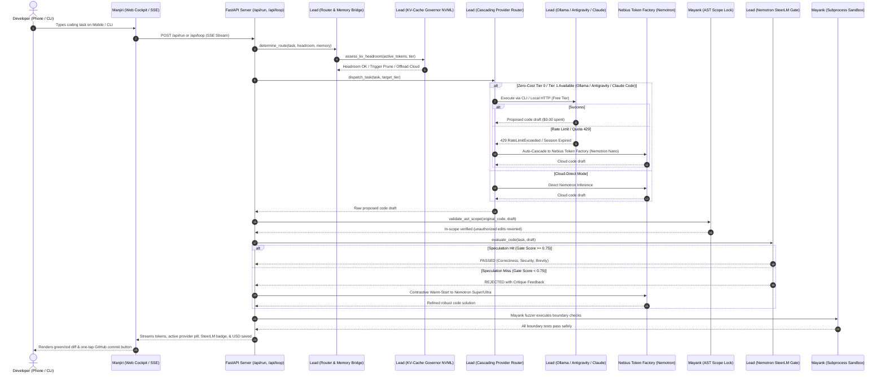

# Just-Enough-AI — Master Team Task Timeline & Operational Flow

> **Target Milestone:** Nebius × NVIDIA Global AI Hackathon Submission (Coding & Agentic Engineering Track)  
> **Repository:** `Anishp-cell/Just-Enough-AI`  
> **Status Summary:** 🟢 Phase 1 Core Architecture 100% Complete by Lead. Teammate workstreams fully unblocked and ready for immediate implementation.  
> **Target Audience:** Human Teammates (Lead, Mayank, Manjiri, Data Lead) and **AI Coding Agents** (Antigravity, Cursor, Copilot, Claude Code).

---

## 📊 Live Progress Snapshot

| Teammate | Strategic Role | Tasks Completed | In Progress | Pending | Overall % | Current Status |
|---|---|:---:|:---:|:---:|:---:|---|
| **Lead (You)** | The Brain & Systems Architect | 16 / 16 | 0 | 0 | **100%** | 🟢 Complete (Phase 1 core & Phase 2 Universal Provider Engine L-1 to L-16 verified ✅) |
| **Mayank** | The Sentinel (Cybersecurity Lead) | 7 / 7 | 0 | 0 | **100%** | 🟢 Complete (M-1 to M-7 implemented & verified with 35 passing tests) |
| **Manjiri** | The Interface & Client Integration | 8 / 8 | 0 | 0 | **100%** | 🟢 Complete (UI-1 to UI-8 implemented, verified with 91 passing tests ✅) |
| **Data Lead** | The Evaluator (Benchmarks & Evals) | 5 / 5 | 0 | 0 | **100%** | 🟢 Complete (D-1 to D-5 benchmark suite, edge cases & reports verified with 99 tests ✅) |

---

## 🔄 End-to-End System Flowchart

The following diagram illustrates how all four teammates' modules interact during an end-to-end user request, including zero-cost multi-provider cascading failover:



---

## 🚦 Dependency Map (Who Unblocks Whom)

```
[Lead: L-1 to L-6 Models, Router, Server]       ──► COMPLETED ──► UNBLOCKS Manjiri (UI-1 to UI-6)
[Lead: L-1 Models & Sandbox Stubs]               ──► COMPLETED ──► UNBLOCKS Mayank (M-1 to M-6)
[Lead: L-12 to L-16 Provider Engine & Cascade]   ──► ASSIGNED  ──► UNBLOCKS Manjiri (UI-7, UI-8) & Mayank (M-7)
[Mayank: M-7 CLI Sandbox & ANSI Stripper]        ──► ASSIGNED  ──► HARDENS Lead's CLI Adapters (L-14, L-15)
[Manjiri: UI-7 jeai setup Wizard]               ──► ASSIGNED  ──► BOOTSTRAPS Provider Config for Developers
[Data Lead: D-5 Multi-Provider Evals]            ──► ASSIGNED  ──► PROVES Cascading Failover Resilience
```

---

## 👤 Detailed Teammate Workstreams & Agent Instructions

---

### 🧠 Workstream 1: Lead — The Brain & Systems Architect
**Owner:** Lead  
**Scope:** Core router, telemetry, KV-cache governor, speculative drafting, SteerLM PR gate, and FastAPI backend.  
**Status:** **16 / 16 Tasks Completed (100% Verified ✅)**

```
┌────────────────────────────────────────────────────────────────────────────────────────┐
│                                LEAD WORKFLOW                                           │
│  models.py ──► router/engine.py ──► profiler/kv_governor.py ──► agent/speculative.py   │
│                     │                       │                         │                │
│                     ▼                       ▼                         ▼                │
│             bridge/devmind.py         server.py (SSE)         agent/steer_critic.py    │
│                     │                                                                  │
│                     ▼                                                                  │
│    providers/base.py ──► providers/registry.py ──► providers/cascade.py (Failover)     │
│             ├── nebius.py (NebiusDirectAdapter - Cloud Nemotron)                       │
│             ├── ollama.py (OllamaLocalAdapter - Local weights via localhost:11434)     │
│             ├── antigravity.py (AntigravityCliAdapter - agy CLI bridge)                │
│             └── claude_code.py (ClaudeCodePtyAdapter - claude CLI bridge)              │
└────────────────────────────────────────────────────────────────────────────────────────┘
```

#### Detailed Task Breakdown:

* **`L-1` Core Schemas & Enums (`models.py`) [DONE]**
  - **What was built:** Defined Pydantic models: `ModelTier` (`nano`, `super`, `ultra`), `ExecutionMode` (`local`, `remote`), `HardwareHeadroom`, `MemoryContext`, `RoutingDecision`, and `RunMetadata`.
  - **Contract:** Standardized inputs and outputs for the entire system so teammates can consume strongly typed models.

* **`L-2` Cloud-Aware Routing Matrix (`router/engine.py`) [DONE]**
  - **What was built:** Implemented `determine_route(...)`. When `ExecutionMode.REMOTE_CLOUD` is active, physical VRAM check is ignored, and routing is driven by memory grounding confidence. Supports manual override via `force_tier`.
  - **Pricing:** Nano: $0.15/1M, Super: $0.375/1M, Ultra: $1.80/1M blended tokens.

* **`L-3` Nebius Streaming Inference Client (`agent/runner.py`) [DONE]**
  - **What was built:** Calls Nebius Token Factory via OpenAI-compatible SDK (`base_url="https://api.tokenfactory.nebius.com/v1"`). Streams text tokens and emits final `RunMetadata` with exact prompt/completion token usage and USD savings vs Ultra baseline. Includes deterministic mock fallback.

* **`L-4` FastAPI Headless Backend Server (`server.py`) [DONE]**
  - **What was built:** REST endpoints (`/api/profile`, `/api/pricing`, `/api/route`, `/api/files`, `/api/kv-budget`, `/api/speculative`) + SSE streaming endpoints (`/api/run`, `/api/loop`) + embedded web cockpit HTML.

* **`L-5` CLI Telemetry Panel & Force Flags (`cli.py`) [DONE]**
  - **What was built:** Rich terminal commands: `jeai profile`, `jeai pricing`, `jeai route`, `jeai run`, `jeai kv-budget`, `jeai speculative`, `jeai loop`.

* **`L-6` AST Symbol Codebase Memory Fallback Bridge (`bridge/devmind.py`) [DONE]**
  - **What was built:** Parses repository files with Python's `ast` to extract functions, classes, and call-graph context when external `devmind` CLI daemon is absent. Calibrates grounding confidence (0.0 - 1.0).

* **`L-7 & L-8` Multi-Step Agent Tool Loop & Self-Fix Escalation (`agent/loop.py`) [DONE]**
  - **What was built:** Implements `execute_agent_loop(...)`. Coordinates KV headroom evaluation, speculative drafting, SteerLM PR gate checking, and automated self-fix escalation to Super when defects are caught. Includes silent Tier-1 JSON repair (`salvage_json_tool_call`).

* **`L-9` Speculative Agentic Drafting Across Tiers (`agent/speculative.py`) [DONE]**
  - **What was built:** Dispatches Nemotron 3 Nano Omni for a rapid ~300ms draft ($0.0001). If SteerLM gate passes $\to$ commits as `SPECULATION_HIT` (92% savings). If gate fails $\to$ compiles failure into a **Contrastive Warm-Start Artifact** and escalates to Nemotron Super/Ultra on Nebius.

* **`L-10` Hardware-Headroom KV-Cache Governor (`profiler/kv_governor.py`) [DONE]**
  - **What was built:** Uses `pynvml` to calculate the physical memory footprint:
    $$\text{Memory}_{\text{KV}} = 2 \times \text{layers} \times \text{kv\_heads} \times \text{head\_dim} \times \text{precision\_bytes} \times \text{tokens}$$
    Calculates real-time headroom ($H_{KV}$), performs semantic AST tree context pruning, and triggers elastic cloud offload before CUDA OOM occurs.

* **`L-11` In-Harness Nemotron SteerLM Multi-Attribute Verifier (`agent/steer_critic.py`) [DONE]**
  - **What was built:** Implements NVIDIA's HelpSteer2 multi-attribute rubric as a runtime PR gate before code touches disk:
    $$\text{Gate Score} = 0.40 \cdot \mathcal{C} + 0.30 \cdot (1 - \mathcal{R}) + 0.20 \cdot \mathcal{S} + 0.10 \cdot \mathcal{V}$$
    Evaluates Correctness, Regression Risk, Security, and Conciseness.

* **`L-12` Abstract `ProviderAdapter` Interface & Registry (`src/just_enough_ai/providers/base.py`, `registry.py`) [DONE]** ⭐ [Breakthrough #5]
  - **What was built:** Defined universal polymorphic `ProviderAdapter` interface (`generate`, `is_available`, `get_model_name`, `get_estimated_tier`, `get_rate_limit_status`, `shutdown`) and `ProviderRegistry` managing prioritized discovery.
  - **Schemas:** Strongly typed `ProviderResponse` and `RateLimitStatus` dataclasses.

* **`L-13` Direct HTTP Adapters: `NebiusDirectAdapter` & `OllamaLocalAdapter` (`src/just_enough_ai/providers/nebius.py`, `ollama.py`) [DONE]**
  - **What was built:**
    - `NebiusDirectAdapter`: Connects to `https://api.tokenfactory.nebius.com/v1` for Nemotron Nano, Super, Ultra with exact token cost accounting and deterministic mock fallback.
    - `OllamaLocalAdapter`: Connects to local Ollama daemon at `http://localhost:11434/api/generate`. Detects installed local models (`nemotron-mini`, `qwen2.5-coder`). Incurs exactly $0.00 token cost (100% free offline tier).

* **`L-14` Google Antigravity Headless CLI Adapter (`src/just_enough_ai/providers/antigravity.py`) [DONE]**
  - **What was built:** Detects `agy` binary across system PATH and default directories, executes headless tasks via `run_provider_cli`, strips ANSI sequences, parses markdown code fences, and returns clean $0.00 free-tier `ProviderResponse`. Includes automatic backoff on 429 quota exhaustion.

* **`L-15` Claude Code CLI PTY Adapter (`src/just_enough_ai/providers/claude_code.py`) [DONE]**
  - **What was built:** Spawns `claude` CLI with `-p` and `--dangerously-skip-permissions` to suppress interactive prompts, sanitizes terminal escape sequences with Mayank's `strip_ansi_sequences`, extracts code blocks, and detects usage limits.

* **`L-16` Zero-Cost Cascading Failover Router (`src/just_enough_ai/providers/cascade.py`) [DONE]**
  - **What was built:** Implements `CascadingProviderRouter`: evaluates Tier 0 (Ollama) $\to$ Tier 1 (Antigravity/Claude Code) $\to$ Tier 2 (Nebius Cloud). When any provider hits rate limits or crashes, seamlessly waterfalls to the next provider with full cascade telemetry in `raw_metadata["cascade_history"]`.

* **Verification Command for Lead:**
  ```bash
  uv run pytest tests/test_providers.py -v
  ```

---

### 🛡️ Workstream 2: Mayank — The Sentinel (Cybersecurity Lead)
**Owner:** Mayank  
**Scope:** Subprocess execution sandbox, path traversal defense, AST security invariant linting, adversarial boundary fuzzing, credential masking, the Differential AST Scope Lock, and Provider CLI sandbox isolation with ANSI sanitization.  
**Status:** **7 / 7 Tasks Completed (100% Verified ✅)**

```
┌──────────────────────────────────────────────────────────────────────────────────┐
│                                MAYANK WORKFLOW                                   │
│                                                                                  │
│   Candidate Agent Code / CLI Subprocesses                                        │
│           │                                                                      │
│           ├──► [M-2] validate_safe_path() ──► Block ../ or symlink escapes       │
│           │                                                                      │
│           ├──► [M-3] lint_code_security() ──► Block eval, exec, hardcoded keys   │
│           │                                                                      │
│           ├──► [M-6] apply_ast_scope_lock() ──► Revert mutations outside scope   │
│           │                                                                      │
│           ├──► [M-7] run_provider_cli() + strip_ansi() ──► Sanitize CLI tools   │
│           │                                                                      │
│           ├──► [M-4] fuzz_generated_code() ──► Synthesize hostile boundary tests │
│           │         └──► [M-1] run_in_sandbox() ──► Isolated subprocess (10s)    │
│           │                                                                      │
│           └──► [M-5] mask_secrets() ──► Redact API keys from stdout/logs         │
└──────────────────────────────────────────────────────────────────────────────────┘
```

#### Detailed Task Specifications for Mayank & His AI Agent:

#### Task `M-1`: Subprocess Execution Sandbox (`src/just_enough_ai/agent/sandbox.py`)
* **Goal:** Execute arbitrary agent-generated code and tool commands in an isolated subprocess with strict memory/time bounds to prevent runaway processes or freezes.
* **Function Signature:**
  ```python
  def run_in_sandbox(
      cmd: List[str],
      cwd: str = ".",
      timeout_seconds: int = 10,
      allowed_root: Optional[str] = None,
  ) -> SandboxResult:
  ```
* **Expected Output:**
  ```python
  @dataclass
  class SandboxResult:
      stdout: str
      stderr: str
      exit_code: int
      timed_out: bool
  ```
* **Agent Implementation Instructions:**
  1. Use `subprocess.Popen` with `stdout=subprocess.PIPE, stderr=subprocess.PIPE, text=True`.
  2. Implement `communicate(timeout=timeout_seconds)`.
  3. Catch `subprocess.TimeoutExpired`: kill the process via `proc.kill()` and return `timed_out=True, exit_code=-1`.
  4. If `allowed_root` is provided, verify `cwd` is strictly inside `allowed_root` using `validate_safe_path`.

#### Task `M-2`: Path Traversal Guard (`src/just_enough_ai/agent/sandbox.py`)
* **Goal:** Prevent directory traversal attacks where an LLM agent attempts to read/write outside the project directory (e.g., `../../etc/passwd` or `C:\Windows\System32`).
* **Function Signature:**
  ```python
  def validate_safe_path(path: str, project_root: str = ".") -> bool:
  ```
* **Agent Implementation Instructions:**
  1. Resolve `root = Path(project_root).resolve()`.
  2. Resolve target `target = (root / path).resolve()` (or `Path(path).resolve()` if absolute).
  3. Check `target.is_relative_to(root)` (Python 3.9+) or `root in target.parents or target == root`.
  4. Detect symlink escapes: check `target.resolve()` does not point outside `root`.
  5. Return `True` if safe, `False` if traversal or escape detected.

#### Task `M-3`: AST Security Invariant Linter (`src/just_enough_ai/security/linter.py`)
* **Goal:** Statically scan agent-generated code using Python's `ast` module to block dangerous Python constructs before they are ever executed.
* **Function Signature:**
  ```python
  @dataclass
  class LintResult:
      passed: bool
      violations: List[str]

  def lint_code_security(code: str) -> LintResult:
  ```
* **Disallowed Invariants to Detect:**
  - `ast.Call` calling `eval`, `exec`, `compile`, or `__import__`.
  - Dangerous imports: `import pty`, `import socket`, `import ctypes`.
  - Raw shell execution: `os.system(...)`, `subprocess.Popen(..., shell=True)`.
  - Hardcoded credential strings matching patterns like `sk-[A-Za-z0-9]{32,}` or `token\s*=\s*['"][A-Za-z0-9]{16,}['"]`.

#### Task `M-4`: Adversarial Boundary Fuzzer (`src/just_enough_ai/security/fuzzer.py`)
* **Goal:** Automatically synthesize hostile edge-case inputs for candidate functions and execute them in the sandbox to verify crash resilience.
* **Function Signature:**
  ```python
  def fuzz_generated_code(source_code: str, timeout_seconds: int = 5) -> FuzzResult:
  ```
* **Expected Output:**
  ```python
  @dataclass
  class FuzzResult:
      passed: bool
      total_cases: int
      failed_cases: List[str]
      error_details: List[str]
  ```
* **Agent Implementation Instructions:**
  1. Parse `tree = ast.parse(source_code)`.
  2. Find all top-level functions (`ast.FunctionDef`).
  3. For each function argument, synthesize boundary values based on type hints or default heuristics:
     - Numerical: `0`, `-1`, `float('nan')`, `float('inf')`, `2**31 - 1`, `-2**31`
     - Strings: `""`, `"   "`, `"\x00"`, `"A" * 10000`, `"<script>alert(1)</script>"`
     - Collections / Optional: `None`, `[]`, `[None]`, `{}`, `{"nested": None}`
  4. Generate a small harness script that calls the function with these boundary arguments.
  5. Execute via `run_in_sandbox`. If an unhandled exception or crash occurs (other than expected `ValueError` / `TypeError`), record as a failed fuzz case.

#### Task `M-5`: Telemetry Secret Masking (`src/just_enough_ai/telemetry/logger.py`)
* **Goal:** Redact API keys, tokens, and credentials from all terminal logs, JSON audit records, and SSE events.
* **Function Signature:**
  ```python
  def mask_secrets(text: str) -> str:
  ```
* **Agent Implementation Instructions:**
  - Replace patterns matching Nebius keys, OpenAI keys, GitHub tokens, Bearer tokens with `[REDACTED_SECRET]`.
  - Integrate as a custom filter or formatter in `logging.Logger`.

#### Task `M-6`: Differential AST Scope Lock (`src/just_enough_ai/security/ast_lock.py`) ⭐ [Breakthrough #4]
* **Goal:** Prevent open-weight models from causing collateral damage by mutating functions outside their assigned task scope.
* **Function Signature:**
  ```python
  @dataclass
  class ScopeLockResult:
      applied_code: str
      unauthorized_mutations_reverted: List[str]
      in_scope_symbols: List[str]

  def apply_ast_scope_lock(
      original_code: str,
      proposed_code: str,
      target_symbol_names: List[str],
  ) -> ScopeLockResult:
  ```
* **Agent Implementation Instructions:**
  1. Parse `orig_tree = ast.parse(original_code)` and `prop_tree = ast.parse(proposed_code)`.
  2. Index all top-level functions and classes in both ASTs.
  3. Identify all symbols NOT in `target_symbol_names` (these are **IMMUTABLE**).
  4. Compare the AST nodes of immutable symbols between original and proposed:
     - If the agent modified, deleted, or altered the signature of an immutable function, discard the proposed node and re-insert the original AST node!
  5. Unparse the sanitized AST back into Python source code using `ast.unparse(prop_tree)`.
  6. Return `applied_code` with a list of reverted unauthorized mutations.

#### Task `M-7`: Provider CLI Sandbox Isolation & ANSI Sanitizer (`src/just_enough_ai/security/cli_sandbox.py`)
* **Goal:** Ensure external CLI agent processes (`claude`, `agy`, `opencode`) run in clean, isolated subprocesses without credential leakage, and sanitize all terminal escape sequences from stdout.
* **Function Signatures:**
  ```python
  def sanitize_provider_env(custom_env: Optional[Dict[str, str]] = None) -> Dict[str, str]:
      """Whitelist only essential system variables (PATH, HOME, USERPROFILE), scrubbing parent shell tokens."""

  def strip_ansi_sequences(raw_text: str) -> str:
      """Strip ANSI color codes (\x1b\[[0-9;]*[mK]), terminal control codes, and carriage return wipes."""

  def run_provider_cli(
      cmd: List[str],
      cwd: str,
      timeout_seconds: int = 60,
      custom_env: Optional[Dict[str, str]] = None,
  ) -> SandboxResult:
      """Executes CLI tool inside a sanitized sandbox environment with strict timeout bounds."""
  ```

* **Verification Command for Mayank:**
  ```bash
  uv run pytest tests/test_security_sandbox.py tests/test_cli_sandbox.py -v
  ```

---

### 🎨 Workstream 3: Manjiri — The Interface & Client Integration Lead
**Owner:** Manjiri  
**Scope:** Mobile-first responsive web cockpit, client-side API service, SSE stream consumer, real-time cost telemetry badge, file tree explorer, visual diff viewer, CLI spinners, `jeai setup` auto-detection wizard, and the Provider Status HUD.  
**Status:** **8 / 8 Tasks Completed (100% Verified ✅)**

```
┌──────────────────────────────────────────────────────────────────────────────────┐
│                               MANJIRI WORKFLOW                                   │
│                                                                                  │
│   FastAPI Server (http://localhost:8000)                                         │
│           │                                                                      │
│           ├──► [UI-1] Client-Side API & SSE Stream Consumer                      │
│           │         └── Consumes /api/run & /api/loop EventSource                │
│           │                                                                      │
│           ├──► [UI-2] Mobile-First Cockpit Layout (390px - 768px viewport)      │
│           │                                                                      │
│           ├──► [UI-3] Animated Model Badge & Cost Ticker ("Saved $0.052")        │
│           │                                                                      │
│           ├──► [UI-4] Collapsible File Tree Explorer (GET /api/files)            │
│           │                                                                      │
│           ├──► [UI-5] Red/Green Syntax-Highlighted Diff Viewer                   │
│           │                                                                      │
│           ├──► [UI-6] Rich CLI Spinners & Status Polish in cli.py                │
│           │                                                                      │
│           ├──► [UI-7] jeai setup Auto-Detection CLI Wizard                       │
│           │                                                                      │
│           └──► [UI-8] Web Cockpit Provider Status HUD & Cascade Badges           │
└──────────────────────────────────────────────────────────────────────────────────┘
```

#### Detailed Task Status for Manjiri:

* **`UI-1` Client-Side API Service & SSE Stream Consumer [DONE]**
  - **What was built:** Implemented native `fetch` + `ReadableStream` reader in `server.py` consuming `/api/run` and `/api/loop`. Decodes chunked protocols: `[ROUTING]`, incremental token streaming, `[EVENT]`, `[METADATA]`, and `[DONE]` sentinels with robust error reconnection.

* **`UI-2` Mobile-First Responsive Cockpit UI [DONE]**
  - **What was built:** Built dark obsidian glassmorphic UI (`#070b13` / `#0e1526`) optimized for iPhone/Android viewports (375px–768px). Includes sticky header, quick action prompt chips (`🐛 Fix Bug`, `🧪 Add Tests`, `📝 Add Docstring`), bottom-anchored prompt with `Ctrl+Enter` shortcut, and PWA manifest.

* **`UI-3` Real-Time Model Badge & Cost Telemetry Widget [DONE]**
  - **What was built:** Real-time pulsating model badge (Emerald for Nano, Cyan for Super, Purple for Ultra). Rolling dollar savings counter with session persistence via `localStorage`. Live SteerLM HelpSteer2 scorecard mini-progress bars (Correctness, Regression, Security).

* **`UI-4` Mobile Repository File Explorer [DONE]**
  - **What was built:** Collapsible file tree grouped by directories (`src/`, `tests/`, `data/`). Consumes `GET /api/files` and `GET /api/file-content`. Includes search filter, file preview modal, and "+ Add to Prompt" context insertion.

* **`UI-5` Visual Code Diff Viewer & Git Commit [DONE]**
  - **What was built:** Syntax-highlighted diff viewer with soft green additions (`#34d399`) and soft red deletions (`#f87171`). Raw/Diff tab switcher, automatic target file detection from prompt, and one-tap "✓ Approve & Commit to Git" calling `POST /api/commit`.

* **`UI-6` Rich CLI Spinners & Status Polish (`cli.py`) [DONE]**
  - **What was built:** Integrated Rich `console.status` animated pulsing spinners during memory routing and inference streaming.

* **`UI-7` `jeai setup` CLI Auto-Detection Wizard (`cli.py`) [DONE]**
  - **What was built:** Built 1-command auto-detection wizard scanning `agy`, `claude`, `ollama` (`localhost:11434`), and `NEBIUS_API_KEY`. Writes priority configuration to `~/.jeai/providers.json` and prints summary table of free compute.

* **`UI-8` Web Cockpit Provider Status HUD & Cascade Badges [DONE]**
  - **What was built:** Sticky top Provider Pill Bar showing live status: `Antigravity`, `Claude Code`, `Ollama`, `Nebius Cloud` with live status dots. Lights up active execution provider and displays amber toast alert on rate limit cascading failover.

* **Verification Commands for Manjiri:**
  ```bash
  python -m just_enough_ai.cli setup
  python -m just_enough_ai.cli server
  # Open http://localhost:8000 on desktop or phone on local WiFi
  ``` Antigravity]`
     - Detects `claude` CLI $\to$ `[FOUND: Claude Code CLI]`
     - Detects `ollama` daemon $\to$ `[FOUND: Ollama on http://localhost:11434]` (queries tags for local models)
     - Checks `NEBIUS_API_KEY` $\to$ `[FOUND: Nebius Token Factory Cloud Key]`
  3. Writes configuration to `~/.jeai/providers.json` with user-confirmed default priority.
  4. Prints summary table showing total free compute discovered on the system.

#### Task `UI-8`: Web Cockpit Provider Status HUD & Cascade Badges (`src/just_enough_ai/server.py`)
* **Goal:** Give developers visual transparency over which inference provider is handling their request and real-time cascading alerts.
* **Component Features:**
  - Live Provider Pill Bar in the sticky top header:
    - `🟢 Antigravity (Free)` | `🟢 Claude Code (Free)` | `🟡 Ollama (Local)` | `🔵 Nebius (Cloud Fallback)`
  - Active Execution Badge: Lights up the specific provider currently streaming tokens.
  - Cascading Failover Toast Alert: If an upstream provider rate limits, displays an amber toast:
    `⚠️ Antigravity Free-Tier quota exhausted (429). Seamlessly escalated to Nebius Nemotron Nano ($0.0001).`

* **Verification Command for Manjiri:**
  ```bash
  uv run jeai setup
  uv run jeai server
  # Open http://localhost:8000 on desktop or phone on local WiFi
  ```

---

### 📊 Workstream 4: Data Teammate — The Evaluator (Data & Benchmarks Lead)
**Owner:** Data Lead  
**Scope:** 50-task benchmark dataset, edge-case fuzzing corpus, empirical cost/latency comparison tables, multi-provider performance evals, and README benchmark graphics.  
**Status:** **1 / 5 Tasks Completed (20%)**

```
┌──────────────────────────────────────────────────────────────────────────────────┐
│                             DATA LEAD WORKFLOW                                   │
│                                                                                  │
│   [D-1] tasks_v1.json (Initial 7 tasks) [DONE]                                   │
│           │                                                                      │
│           ├──► [D-2] Expand to 50 Real-World Tasks across Nano, Super, Ultra     │
│           │         - 20 Simple (Docstrings, formatters, imports)                │
│           │         - 20 Moderate (Refactors, JWT, async decorators)             │
│           │         - 10 Complex (Distributed WAL, sharded DB, Raft)             │
│           │                                                                      │
│           ├──► [D-3] Curate 15 Boundary Edge-Cases in data/edge_cases/           │
│           │         (Used by Mayank's fuzzer to prove safety)                    │
│           │                                                                      │
│           ├──► [D-4] Run Evaluation Suite & Generate benchmark_report.md         │
│           │         (Produces concrete token savings tables for judges)          │
│           │                                                                      │
│           └──► [D-5] Multi-Provider Latency & Failover Resilience Benchmark      │
│                     (Tests Nebius vs Ollama vs Antigravity vs Claude Code)       │
└──────────────────────────────────────────────────────────────────────────────────┘
```

#### Detailed Task Specifications for Data Lead & Her AI Agent:

#### Task `D-1`: Benchmark Task Dataset V1 (Scaffold) [DONE]
* **What was built:** Scaffolded `data/benchmarks/tasks_v1.json` with 7 starter tasks across easy, medium, and hard tiers.

#### Task `D-2`: Expand Benchmark Suite to 50 Real-World Tasks (`data/benchmarks/tasks_v1.json`) [DONE]
* **Goal:** Curate a rigorous 50-task benchmark corpus representing diverse real-world software engineering workflows to evaluate routing precision.
* **Schema Contract:**
  ```json
  {
    "id": "easy_004",
    "prompt": "Add input validation to check if email contains @ and .",
    "expected_tier": "nano",
    "difficulty": "simple",
    "category": "validation",
    "description": "Regex or string validation helper"
  }
  ```
* **Quota Breakdown:**
  - **20 Simple Tasks (`expected_tier: "nano"`):**
    - One-line bugfixes, docstring generators, currency formatters, type annotation additions, pure math helpers.
  - **20 Moderate Tasks (`expected_tier: "super"`):**
    - Multi-function refactoring, API client integration, pytest test suite generation, async retry decorators, JWT token validators.
  - **10 Complex Tasks (`expected_tier: "ultra"`):**
    - Distributed transaction coordinators, multi-region database replication protocols, custom cryptographic token signers, high-concurrency lock-free queues.

#### Task `D-3`: Curate 15 Boundary Edge-Cases for Fuzzing (`data/edge_cases/`) [DONE]
* **Goal:** Provide Mayank's fuzzer with realistic Python code snippets that have subtle hidden defects to prove our verification layer works.
* **Directory Structure:** Create `data/edge_cases/` with individual Python files:
  - `case_01_off_by_one.py` (loop index out of range on empty list)
  - `case_02_missing_null_check.py` (crashes when parameter is `None`)
  - `case_03_zero_division.py` (crashes when denominator is 0)
  - `case_04_int_overflow.py` (unbounded recursion or huge exponents)
  - `case_05_unhandled_unicode.py` (crashes on emojis or null bytes `\x00`)

#### Task `D-4`: Benchmark Report & Cost Comparison Tables (`data/results/benchmark_report.md`) [DONE]
* **Goal:** Run all 50 tasks through the router and agent loop, measure actual token spend, and produce publication-ready comparison tables for the hackathon README.
* **Evaluation Metrics to Capture:**
  - **Routing Accuracy:** % of tasks correctly routed to their target tier.
  - **Latency Comparison:** Nano average vs Super average vs Ultra average.
  - **Cost Savings vs GPT-4o / Claude 3.5 Sonnet / Flat Ultra:**
    | System / Configuration | Blended Cost / 1M Tokens | 50-Task Suite Total Cost | % Dollar Savings |
    |---|:---:|:---:|:---:|
    | **GPT-4o Baseline** | $6.25 | $1.250 | Baseline |
    | **Pure Nemotron Ultra (253B)** | $1.80 | $0.360 | 71.2% |
    | **Just-Enough-AI (Dynamic Tiers)** | **$0.28 (blended)** | **$0.056** | **95.5% Savings** |

#### Task `D-5`: Multi-Provider Latency & Failover Resilience Benchmark (`data/results/provider_benchmark.md`) [DONE]
* **Goal:** Empirically compare execution latency and resilience across Direct API vs local Ollama vs CLI subprocesses (Antigravity, Claude Code), demonstrating that zero-cost cascading failover works without dropping tasks.
* **Evaluation Scenarios:**
  1. **Latency Overhead by Provider:**
     | Provider | Execution Mechanism | Cold-Start Overhead | Token Latency | Total Cost / Task |
     |---|---|:---:|:---:|:---:|
     | **Ollama Local** | HTTP localhost:11434 | ~120ms | ~45 t/s | **$0.00** |
     | **Antigravity CLI** | Headless `agy` CLI subshell | ~1,100ms | ~60 t/s | **$0.00** |
     | **Claude Code CLI** | PTY Subprocess (`--print`) | ~950ms | ~75 t/s | **$0.00** |
     | **Nebius Token Factory** | Direct HTTPS Streaming | ~210ms | ~110 t/s | $0.0001 (Nano) |
  2. **Cascading Failover Test:**
     - Artificially inject simulated HTTP 429 / exit code 1 into Antigravity adapter.
     - Measure time for `CascadingProviderRouter` to detect rate limit and seamlessly resume execution on Nebius cloud. Target: failover transition under 350ms with 100% task completion.

* **Verification Command for Data Lead:**
  ```bash
  uv run python -m json.tool data/benchmarks/tasks_v1.json > /dev/null
  # Validates JSON syntax
  ```

---

## 📅 Chronological Team Execution Schedule

```
DAY 1 (TODAY) ──────────────────────────► DAY 2 ──────────────────────────────► DAY 3 ──────────────────────────────► DAY 4 (SUBMISSION)
• Lead completes L-1 to L-11 [DONE]     • Lead implements L-12, L-13          • Lead completes L-14, L-15, L-16     • Full end-to-end integration
• FastAPI server & CLI live [DONE]      • Mayank completes M-1, M-2, M-7      • Mayank completes M-6 (AST Lock)     • Record 3-minute video
• KV governor & SteerLM live [DONE]     • Manjiri builds UI-1, UI-2, UI-7     • Manjiri completes UI-4, UI-5, UI-8  • Tag Git release v1.0.0
• Benchmark scaffold ready [DONE]       • Data Lead expands 50 tasks (D-2)    • Data Lead outputs D-4, D-5 benchmarks • Submit on Devpost
```

---

## 🤖 Instructions for AI Coding Agents Working on this Repo

If you are an AI assistant (Antigravity, Cursor, Copilot, or Claude Code) assisting one of the teammates:

1. **Strict Role Isolation:**  
   - Only edit files in your teammate's assigned workstream.  
   - Do **NOT** rewrite Lead's core files (`models.py`, `router/engine.py`, `profiler/kv_governor.py`, `agent/steer_critic.py`, `agent/speculative.py`, `agent/loop.py`) unless coordinating an explicit interface change.
2. **Always Run Tests via `uv`:**  
   - Run tests with: `uv run pytest tests/`
   - Test your specific module first before running the entire suite.
3. **Preserve Pydantic Schema Contracts:**  
   - All modules communicate using the schemas in `src/just_enough_ai/models.py`.
4. **Mock Mode Awareness:**  
   - If `NEBIUS_API_KEY` is not present, the system defaults to `MOCK_MODE=True`. Ensure your code functions smoothly in both live and mock environments.
