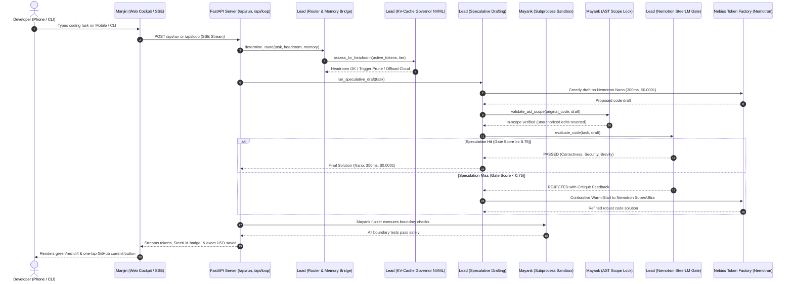

# Just-Enough-AI — Master Team Task Timeline & Operational Flow

> **Target Milestone:** Nebius × NVIDIA Global AI Hackathon Submission (Coding & Agentic Engineering Track)  
> **Repository:** `Anishp-cell/Just-Enough-AI`  
> **Status Summary:** 🟢 Phase 1 Core Architecture 100% Complete by Lead. Teammate workstreams fully unblocked and ready for immediate implementation.  
> **Target Audience:** Human Teammates (Lead, Mayank, Manjiri, Data Lead) and **AI Coding Agents** (Antigravity, Cursor, Copilot, Claude Code).

---

## 📊 Live Progress Snapshot

| Teammate | Strategic Role | Tasks Completed | In Progress | Pending | Overall % | Current Status |
|---|---|:---:|:---:|:---:|:---:|---|
| **Lead (You)** | The Brain & Systems Architect | 11 / 11 | 0 | 0 | **100%** | 🟢 Core architecture, router, KV governor, SteerLM gate, & speculative loop live |
| **Mayank** | The Sentinel (Cybersecurity Lead) | 0 / 6 | 0 | 6 | **0%** | 🟡 Ready to start (Stubs & contracts published in `agent/sandbox.py`, `security/`) |
| **Manjiri** | The Interface & Client Integration | 0 / 6 | 0 | 6 | **0%** | 🟡 Ready to start (FastAPI REST + SSE endpoints live at `http://localhost:8000`) |
| **Data Lead** | The Evaluator (Benchmarks & Evals) | 1 / 4 | 0 | 3 | **25%** | 🟡 Ready to expand `tasks_v1.json` to 50 tasks and run cost benchmarking |

---

## 🔄 End-to-End System Flowchart

The following diagram illustrates how all four teammates' modules interact during an end-to-end user request:



---

## 🚦 Dependency Map (Who Unblocks Whom)

```
[Lead: L-1 to L-6 Models, Router, Server] ──► COMPLETED ──► UNBLOCKS Manjiri (UI-1 to UI-5)
[Lead: L-1 Models & Sandbox Stubs]         ──► COMPLETED ──► UNBLOCKS Mayank (M-1 to M-6)
[Mayank: M-1 Sandbox & M-4 Fuzzer]        ──► IN PROGRESS ──► HARDENS Lead's Self-Fix Loop
[Mayank: M-6 AST Scope Lock]              ──► IN PROGRESS ──► GUARDS Speculative Drafting
[Data Lead: D-2 50 Tasks]                 ──► IN PROGRESS ──► FEEDS D-4 Final Benchmark Proof
```

---

## 👤 Detailed Teammate Workstreams & Agent Instructions

---

### 🧠 Workstream 1: Lead — The Brain & Systems Architect
**Owner:** Lead  
**Scope:** Core router, telemetry, KV-cache governor, speculative drafting, SteerLM PR gate, and FastAPI backend.  
**Status:** **100% Completed (All 11 Tasks Done)**

```
┌──────────────────────────────────────────────────────────────────────────────────┐
│                                LEAD WORKFLOW                                     │
│  models.py ──► router/engine.py ──► profiler/kv_governor.py ──► agent/speculative.py │
│                     │                       │                         │          │
│                     ▼                       ▼                         ▼          │
│             bridge/devmind.py         server.py (SSE)         agent/steer_critic.py│
└──────────────────────────────────────────────────────────────────────────────────┘
```

#### Detailed Task Breakdown:

* **`L-1` Core Schemas & Enums (`models.py`) [DONE]**
  - **What was built:** Defined Pydantic models: `ModelTier` (`nano`, `super`, `ultra`), `ExecutionMode` (`local`, `remote`), `HardwareHeadroom`, `MemoryContext`, `RoutingDecision`, and `RunMetadata`.
  - **Contract:** Standardized inputs and outputs for the entire system so teammates can consume strongly typed models.

* **`L-2` Cloud-Aware Routing Matrix (`router/engine.py`) [DONE]**
  - **What was built:** Implemented `determine_route(...)`. When `ExecutionMode.REMOTE_CLOUD` is active, physical VRAM check is ignored, and routing is driven by memory grounding confidence. Supports manual override via `force_tier`.
  - **Pricing:** Nano: $0.15/1M, Super: $0.375/1M, Ultra: $1.80/1M blended tokens.

* **`L-3` Nebius Streaming Inference Client (`agent/runner.py`) [DONE]**
  - **What was built:** Calls Nebius Token Factory via OpenAI-compatible SDK (`base_url="https://api.tokenfactory.nebius.com/v1"`). Streams text tokens and emits final `RunMetadata` with exact prompt/completion token usage and USD savings vs Ultra baseline. Includes deterministic mock fallback.

* **`L-4` FastAPI Headless Backend Server (`server.py`) [DONE]**
  - **What was built:** REST endpoints (`/api/profile`, `/api/pricing`, `/api/route`, `/api/files`, `/api/kv-budget`, `/api/speculative`) + SSE streaming endpoints (`/api/run`, `/api/loop`) + embedded web cockpit HTML.

* **`L-5` CLI Telemetry Panel & Force Flags (`cli.py`) [DONE]**
  - **What was built:** Rich terminal commands: `jeai profile`, `jeai pricing`, `jeai route`, `jeai run`, `jeai kv-budget`, `jeai speculative`, `jeai loop`.

* **`L-6` AST Symbol Codebase Memory Fallback Bridge (`bridge/devmind.py`) [DONE]**
  - **What was built:** Parses repository files with Python's `ast` to extract functions, classes, and call-graph context when external `devmind` CLI daemon is absent. Calibrates grounding confidence (0.0 - 1.0).

* **`L-7 & L-8` Multi-Step Agent Tool Loop & Self-Fix Escalation (`agent/loop.py`) [DONE]**
  - **What was built:** Implements `execute_agent_loop(...)`. Coordinates KV headroom evaluation, speculative drafting, SteerLM PR gate checking, and automated self-fix escalation to Super when defects are caught. Includes silent Tier-1 JSON repair (`salvage_json_tool_call`).

* **`L-9` Speculative Agentic Drafting Across Tiers (`agent/speculative.py`) [DONE]**
  - **What was built:** Dispatches Nemotron 3 Nano Omni for a rapid ~300ms draft ($0.0001). If SteerLM gate passes $\to$ commits as `SPECULATION_HIT` (92% savings). If gate fails $\to$ compiles failure into a **Contrastive Warm-Start Artifact** and escalates to Nemotron Super/Ultra on Nebius.

* **`L-10` Hardware-Headroom KV-Cache Governor (`profiler/kv_governor.py`) [DONE]**
  - **What was built:** Uses `pynvml` to calculate the physical memory footprint:
    $$\text{Memory}_{\text{KV}} = 2 \times \text{layers} \times \text{kv\_heads} \times \text{head\_dim} \times \text{precision\_bytes} \times \text{tokens}$$
    Calculates real-time headroom ($H_{KV}$), performs semantic AST tree context pruning, and triggers elastic cloud offload before CUDA OOM occurs.

* **`L-11` In-Harness Nemotron SteerLM Multi-Attribute Verifier (`agent/steer_critic.py`) [DONE]**
  - **What was built:** Implements NVIDIA's HelpSteer2 multi-attribute rubric as a runtime PR gate before code touches disk:
    $$\text{Gate Score} = 0.40 \cdot \mathcal{C} + 0.30 \cdot (1 - \mathcal{R}) + 0.20 \cdot \mathcal{S} + 0.10 \cdot \mathcal{V}$$
    Evaluates Correctness, Regression Risk, Security, and Conciseness.

---

### 🛡️ Workstream 2: Mayank — The Sentinel (Cybersecurity Lead)
**Owner:** Mayank  
**Scope:** Subprocess execution sandbox, path traversal defense, AST security invariant linting, adversarial boundary fuzzing, credential masking, and the Differential AST Scope Lock.  
**Status:** **0 / 6 Tasks Completed (Ready to Execute)**

```
┌──────────────────────────────────────────────────────────────────────────────────┐
│                                MAYANK WORKFLOW                                   │
│                                                                                  │
│   Candidate Agent Code                                                           │
│           │                                                                      │
│           ├──► [M-2] validate_safe_path() ──► Block ../ or symlink escapes       │
│           │                                                                      │
│           ├──► [M-3] lint_code_security() ──► Block eval, exec, hardcoded keys   │
│           │                                                                      │
│           ├──► [M-6] apply_ast_scope_lock() ──► Revert mutations outside scope   │
│           │                                                                      │
│           ├──► [M-4] fuzz_generated_code() ──► Synthesize hostile boundary tests │
│           │         └──► [M-1] run_in_sandbox() ──► Isolated subprocess (10s)    │
│           │                                                                      │
│           └──► [M-5] mask_secrets() ──► Redact API keys from stdout/logs         │
└──────────────────────────────────────────────────────────────────────────────────┘
```

#### Detailed Task Specifications for Mayank & His AI Agent:

#### Task `M-1`: Subprocess Execution Sandbox (`src/just_enough_ai/agent/sandbox.py`)
* **Goal:** Execute arbitrary agent-generated code and tool commands in an isolated subprocess with strict memory/time bounds to prevent runaway processes or freezes.
* **Function Signature:**
  ```python
  def run_in_sandbox(
      cmd: List[str],
      cwd: str = ".",
      timeout_seconds: int = 10,
      allowed_root: Optional[str] = None,
  ) -> SandboxResult:
  ```
* **Expected Output:**
  ```python
  @dataclass
  class SandboxResult:
      stdout: str
      stderr: str
      exit_code: int
      timed_out: bool
  ```
* **Agent Implementation Instructions:**
  1. Use `subprocess.Popen` with `stdout=subprocess.PIPE, stderr=subprocess.PIPE, text=True`.
  2. Implement `communicate(timeout=timeout_seconds)`.
  3. Catch `subprocess.TimeoutExpired`: kill the process via `proc.kill()` and return `timed_out=True, exit_code=-1`.
  4. If `allowed_root` is provided, verify `cwd` is strictly inside `allowed_root` using `validate_safe_path`.

#### Task `M-2`: Path Traversal Guard (`src/just_enough_ai/agent/sandbox.py`)
* **Goal:** Prevent directory traversal attacks where an LLM agent attempts to read/write outside the project directory (e.g., `../../etc/passwd` or `C:\Windows\System32`).
* **Function Signature:**
  ```python
  def validate_safe_path(path: str, project_root: str = ".") -> bool:
  ```
* **Agent Implementation Instructions:**
  1. Resolve `root = Path(project_root).resolve()`.
  2. Resolve target `target = (root / path).resolve()` (or `Path(path).resolve()` if absolute).
  3. Check `target.is_relative_to(root)` (Python 3.9+) or `root in target.parents or target == root`.
  4. Detect symlink escapes: check `target.resolve()` does not point outside `root`.
  5. Return `True` if safe, `False` if traversal or escape detected.

#### Task `M-3`: AST Security Invariant Linter (`src/just_enough_ai/security/linter.py`)
* **Goal:** Statically scan agent-generated code using Python's `ast` module to block dangerous Python constructs before they are ever executed.
* **Function Signature:**
  ```python
  @dataclass
  class LintResult:
      passed: bool
      violations: List[str]

  def lint_code_security(code: str) -> LintResult:
  ```
* **Disallowed Invariants to Detect:**
  - `ast.Call` calling `eval`, `exec`, `compile`, or `__import__`.
  - Dangerous imports: `import pty`, `import socket`, `import ctypes`.
  - Raw shell execution: `os.system(...)`, `subprocess.Popen(..., shell=True)`.
  - Hardcoded credential strings matching patterns like `sk-[A-Za-z0-9]{32,}` or `token\s*=\s*['"][A-Za-z0-9]{16,}['"]`.

#### Task `M-4`: Adversarial Boundary Fuzzer (`src/just_enough_ai/security/fuzzer.py`)
* **Goal:** Automatically synthesize hostile edge-case inputs for candidate functions and execute them in the sandbox to verify crash resilience.
* **Function Signature:**
  ```python
  def fuzz_generated_code(source_code: str, timeout_seconds: int = 5) -> FuzzResult:
  ```
* **Expected Output:**
  ```python
  @dataclass
  class FuzzResult:
      passed: bool
      total_cases: int
      failed_cases: List[str]
      error_details: List[str]
  ```
* **Agent Implementation Instructions:**
  1. Parse `tree = ast.parse(source_code)`.
  2. Find all top-level functions (`ast.FunctionDef`).
  3. For each function argument, synthesize boundary values based on type hints or default heuristics:
     - Numerical: `0`, `-1`, `float('nan')`, `float('inf')`, `2**31 - 1`, `-2**31`
     - Strings: `""`, `"   "`, `"\x00"`, `"A" * 10000`, `"<script>alert(1)</script>"`
     - Collections / Optional: `None`, `[]`, `[None]`, `{}`, `{"nested": None}`
  4. Generate a small harness script that calls the function with these boundary arguments.
  5. Execute via `run_in_sandbox`. If an unhandled exception or crash occurs (other than expected `ValueError` / `TypeError`), record as a failed fuzz case.

#### Task `M-5`: Telemetry Secret Masking (`src/just_enough_ai/telemetry/logger.py`)
* **Goal:** Redact API keys, tokens, and credentials from all terminal logs, JSON audit records, and SSE events.
* **Function Signature:**
  ```python
  def mask_secrets(text: str) -> str:
  ```
* **Agent Implementation Instructions:**
  - Replace patterns matching Nebius keys, OpenAI keys, GitHub tokens, Bearer tokens with `[REDACTED_SECRET]`.
  - Integrate as a custom filter or formatter in `logging.Logger`.

#### Task `M-6`: Differential AST Scope Lock (`src/just_enough_ai/security/ast_lock.py`) ⭐ [Breakthrough #4]
* **Goal:** Prevent open-weight models from causing collateral damage by mutating functions outside their assigned task scope.
* **Function Signature:**
  ```python
  @dataclass
  class ScopeLockResult:
      applied_code: str
      unauthorized_mutations_reverted: List[str]
      in_scope_symbols: List[str]

  def apply_ast_scope_lock(
      original_code: str,
      proposed_code: str,
      target_symbol_names: List[str],
  ) -> ScopeLockResult:
  ```
* **Agent Implementation Instructions:**
  1. Parse `orig_tree = ast.parse(original_code)` and `prop_tree = ast.parse(proposed_code)`.
  2. Index all top-level functions and classes in both ASTs.
  3. Identify all symbols NOT in `target_symbol_names` (these are **IMMUTABLE**).
  4. Compare the AST nodes of immutable symbols between original and proposed:
     - If the agent modified, deleted, or altered the signature of an immutable function, discard the proposed node and re-insert the original AST node!
  5. Unparse the sanitized AST back into Python source code using `ast.unparse(prop_tree)`.
  6. Return `applied_code` with a list of reverted unauthorized mutations.

* **Verification Command for Mayank:**
  ```bash
  uv run pytest tests/test_security_sandbox.py -v
  ```

---

### 🎨 Workstream 3: Manjiri — The Interface & Client Integration Lead
**Owner:** Manjiri  
**Scope:** Mobile-first responsive web cockpit, client-side API service, SSE stream consumer, real-time cost telemetry badge, file tree explorer, visual diff viewer, and CLI spinners.  
**Status:** **0 / 6 Tasks Completed (Ready to Execute)**

```
┌──────────────────────────────────────────────────────────────────────────────────┐
│                               MANJIRI WORKFLOW                                   │
│                                                                                  │
│   FastAPI Server (http://localhost:8000)                                         │
│           │                                                                      │
│           ├──► [UI-1] Client-Side API & SSE Stream Consumer                      │
│           │         └── Consumes /api/run & /api/loop EventSource                │
│           │                                                                      │
│           ├──► [UI-2] Mobile-First Cockpit Layout (390px - 768px viewport)      │
│           │                                                                      │
│           ├──► [UI-3] Animated Model Badge & Cost Ticker ("Saved $0.052")        │
│           │                                                                      │
│           ├──► [UI-4] Collapsible File Tree Explorer (GET /api/files)            │
│           │                                                                      │
│           ├──► [UI-5] Red/Green Syntax-Highlighted Diff Viewer                   │
│           │                                                                      │
│           └──► [UI-6] Rich CLI Spinners & Status Polish in cli.py                │
└──────────────────────────────────────────────────────────────────────────────────┘
```

#### Detailed Task Specifications for Manjiri & Her AI Agent:

#### Task `UI-1`: Client-Side API Service & SSE Stream Consumer
* **Goal:** Implement the JavaScript client layer to consume server endpoints and parse Server-Sent Events (SSE).
* **API Endpoints to Integrate:**
  - `GET /api/profile` $\to$ Returns `{hardware: {...}, execution_mode: "remote"|"local"}`.
  - `GET /api/pricing` $\to$ Returns pricing table for Nano, Super, Ultra.
  - `GET /api/files?root=.` $\to$ Returns `{root: str, files: List[str]}`.
  - `POST /api/route` $\to$ Payload: `{task: str, mode: "remote", force_tier: null}`.
  - `POST /api/run` $\to$ SSE streaming endpoint. Protocol:
    - Event `[ROUTING] { "selected_tier": "nano", ... }`
    - Token chunks: `def format_currency(...`
    - Event `[METADATA] { "actual_cost_usd": 0.000007, "savings_vs_ultra_usd": 0.000079, ... }`
    - Event `[DONE]`
  - `POST /api/loop` $\to$ Multi-step loop SSE protocol:
    - Event `[EVENT] { "step": 1, "event_type": "KV_BUDGET", "message": "..." }`
    - Event `[EVENT] { "step": 2, "event_type": "SPECULATION", ... }`
    - Event `[METADATA] { ... }`
    - Event `[DONE]`

#### Task `UI-2`: Mobile-First Responsive Cockpit UI
* **Goal:** Deliver a dark-themed, glassmorphic UI optimized for smartphone screens (iPhone/Android viewports 375px - 430px wide) so a user can code from anywhere with their laptop powered off.
* **Target Files:** `src/just_enough_ai/server.py` (inline HTML) or standalone frontend in `web/`.
* **Design Standards:**
  - Background: Deep obsidian/navy (`#090d16` or `#0b0f19`).
  - Font: JetBrains Mono for code, Plus Jakarta Sans / Inter for labels.
  - Accent colors:
    - Nano: Vibrant Emerald (`#10b981`)
    - Super: Electric Cyan (`#06b6d4`)
    - Ultra: Royal Purple (`#8b5cf6`)
  - Sticky header with device profile indicator: `[Cloud Mode ⚡] [RTX 4070 5.9GB Free]`.
  - Bottom-anchored prompt input bar with quick action chips: `"Add Docstring"`, `"Fix Bug"`, `"Add Tests"`.

#### Task `UI-3`: Real-Time Model Badge & Cost Telemetry Widget
* **Goal:** An animated HUD showing the current active Nemotron tier and a rolling dollar ticker demonstrating cost savings.
* **Component Features:**
  - Dynamic badge pulsing with the active model tier: `NVIDIA Nemotron Nano Omni ($0.15/1M)`.
  - Ticker animation counting: `"Cost: $0.00001 | Saved: $0.00018 (92.1% reduction vs Ultra)"`.
  - HelpSteer2 Shield Scorecard: Displays mini-bars for Correctness (1.0), Regression (0.05), Security (1.0).

#### Task `UI-4`: Mobile Repository File Explorer
* **Goal:** Allow users to browse repository files on their smartphone and tap to insert file context into their prompt.
* **Component Features:**
  - Consumes `GET /api/files`.
  - Collapsible file tree grouped by directory (`src/`, `tests/`, `data/`).
  - Tap file $\to$ previews file contents in modal $\to$ "Add to Context" button attaches file path to prompt.

#### Task `UI-5`: Visual Code Diff Viewer
* **Goal:** A syntax-highlighted diff component rendering added lines in soft green (`#064e3b` background) and removed lines in soft red (`#7f1d1d` background).
* **Component Features:**
  - Unified diff view toggleable to split view on desktop.
  - One-tap "Approve & Commit" button calling a future git-commit endpoint.

#### Task `UI-6`: Rich CLI Spinners & Status Polish (`src/just_enough_ai/cli.py`)
* **Goal:** Polish desktop terminal experience using Rich `Console`, `Live`, and `Progress` spinners.
* **Features:**
  - Pulsing spinner while awaiting Nebius streaming tokens.
  - Formatted colored markdown output for generated solutions.

* **Verification Command for Manjiri:**
  ```bash
  uv run jeai server
  # Open http://localhost:8000 on desktop or phone on local WiFi
  ```

---

### 📊 Workstream 4: Data Teammate — The Evaluator (Data & Benchmarks Lead)
**Owner:** Data Lead  
**Scope:** 50-task benchmark dataset, edge-case fuzzing corpus, empirical cost/latency comparison tables, and README benchmark graphics.  
**Status:** **1 / 4 Tasks Completed (25%)**

```
┌──────────────────────────────────────────────────────────────────────────────────┐
│                             DATA LEAD WORKFLOW                                   │
│                                                                                  │
│   [D-1] tasks_v1.json (Initial 7 tasks) [DONE]                                   │
│           │                                                                      │
│           ├──► [D-2] Expand to 50 Real-World Tasks across Nano, Super, Ultra     │
│           │         - 20 Simple (Docstrings, formatters, imports)                │
│           │         - 20 Moderate (Refactors, JWT, async decorators)             │
│           │         - 10 Complex (Distributed WAL, sharded DB, Raft)             │
│           │                                                                      │
│           ├──► [D-3] Curate 15 Boundary Edge-Cases in data/edge_cases/           │
│           │         (Used by Mayank's fuzzer to prove safety)                    │
│           │                                                                      │
│           └──► [D-4] Run Evaluation Suite & Generate benchmark_report.md         │
│                     (Produces concrete token savings tables for judges)          │
└──────────────────────────────────────────────────────────────────────────────────┘
```

#### Detailed Task Specifications for Data Lead & Her AI Agent:

#### Task `D-1`: Benchmark Task Dataset V1 (Scaffold) [DONE]
* **What was built:** Scaffolded `data/benchmarks/tasks_v1.json` with 7 starter tasks across easy, medium, and hard tiers.

#### Task `D-2`: Expand Benchmark Suite to 50 Real-World Tasks (`data/benchmarks/tasks_v1.json`)
* **Goal:** Curate a rigorous 50-task benchmark corpus representing diverse real-world software engineering workflows to evaluate routing precision.
* **Schema Contract:**
  ```json
  {
    "id": "easy_004",
    "prompt": "Add input validation to check if email contains @ and .",
    "expected_tier": "nano",
    "difficulty": "simple",
    "category": "validation",
    "description": "Regex or string validation helper"
  }
  ```
* **Quota Breakdown:**
  - **20 Simple Tasks (`expected_tier: "nano"`):**
    - One-line bugfixes, docstring generators, currency formatters, type annotation additions, pure math helpers.
  - **20 Moderate Tasks (`expected_tier: "super"`):**
    - Multi-function refactoring, API client integration, pytest test suite generation, async retry decorators, JWT token validators.
  - **10 Complex Tasks (`expected_tier: "ultra"`):**
    - Distributed transaction coordinators, multi-region database replication protocols, custom cryptographic token signers, high-concurrency lock-free queues.

#### Task `D-3`: Curate 15 Boundary Edge-Cases for Fuzzing (`data/edge_cases/`)
* **Goal:** Provide Mayank's fuzzer with realistic Python code snippets that have subtle hidden defects to prove our verification layer works.
* **Directory Structure:** Create `data/edge_cases/` with individual Python files:
  - `case_01_off_by_one.py` (loop index out of range on empty list)
  - `case_02_missing_null_check.py` (crashes when parameter is `None`)
  - `case_03_zero_division.py` (crashes when denominator is 0)
  - `case_04_int_overflow.py` (unbounded recursion or huge exponents)
  - `case_05_unhandled_unicode.py` (crashes on emojis or null bytes `\x00`)

#### Task `D-4`: Benchmark Report & Cost Comparison Tables (`data/results/benchmark_report.md`)
* **Goal:** Run all 50 tasks through the router and agent loop, measure actual token spend, and produce publication-ready comparison tables for the hackathon README.
* **Evaluation Metrics to Capture:**
  - **Routing Accuracy:** % of tasks correctly routed to their target tier.
  - **Latency Comparison:** Nano average vs Super average vs Ultra average.
  - **Cost Savings vs GPT-4o / Claude 3.5 Sonnet / Flat Ultra:**
    | System / Configuration | Blended Cost / 1M Tokens | 50-Task Suite Total Cost | % Dollar Savings |
    |---|:---:|:---:|:---:|
    | **GPT-4o Baseline** | $6.25 | $1.250 | Baseline |
    | **Pure Nemotron Ultra (253B)** | $1.80 | $0.360 | 71.2% |
    | **Just-Enough-AI (Dynamic Tiers)** | **$0.28 (blended)** | **$0.056** | **95.5% Savings** |

* **Verification Command for Data Lead:**
  ```bash
  uv run python -m json.tool data/benchmarks/tasks_v1.json > /dev/null
  # Validates JSON syntax
  ```

---

## 📅 Chronological Team Execution Schedule

```
DAY 1 (TODAY) ──────────────────────────► DAY 2 ──────────────────────────────► DAY 3 ──────────────────────────────► DAY 4 (SUBMISSION)
• Lead completes L-1 to L-11 [DONE]     • Mayank completes M-1, M-2, M-3      • Mayank completes M-6 (AST Lock)     • Record 3-minute video
• FastAPI server & CLI live [DONE]      • Manjiri builds UI-1, UI-2           • Manjiri completes UI-4, UI-5        • Tag Git release v1.0.0
• KV governor & SteerLM live [DONE]     • Data Lead expands 50 tasks (D-2)    • Data Lead outputs D-4 report tables • Submit on Devpost
```

---

## 🤖 Instructions for AI Coding Agents Working on this Repo

If you are an AI assistant (Antigravity, Cursor, Copilot, or Claude Code) assisting one of the teammates:

1. **Strict Role Isolation:**  
   - Only edit files in your teammate's assigned workstream.  
   - Do **NOT** rewrite Lead's core files (`models.py`, `router/engine.py`, `profiler/kv_governor.py`, `agent/steer_critic.py`, `agent/speculative.py`, `agent/loop.py`) unless coordinating an explicit interface change.
2. **Always Run Tests via `uv`:**  
   - Run tests with: `uv run pytest tests/`
   - Test your specific module first before running the entire suite.
3. **Preserve Pydantic Schema Contracts:**  
   - All modules communicate using the schemas in `src/just_enough_ai/models.py`.
4. **Mock Mode Awareness:**  
   - If `NEBIUS_API_KEY` is not present, the system defaults to `MOCK_MODE=True`. Ensure your code functions smoothly in both live and mock environments.
