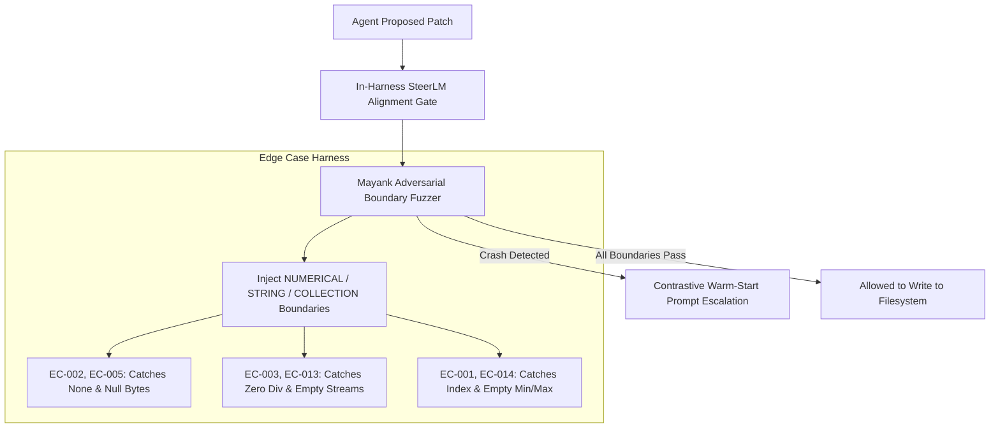

# Adversarial Coding Edge-Cases Corpus (`data/edge_cases/`)

> Curated by the **Data & Benchmarks Team** for the **Just-Enough-AI** project.  
> Used directly to validate **Mayank's Adversarial Security Fuzzer** (`security/fuzzer.py`) and the **In-Harness SteerLM Verifier** (`agent/steer_critic.py`).

---

## 🎯 Purpose

Coding agents often generate code that looks plausible on the surface and passes happy-path tests, but fails catastrophically in production when encountering boundary values:
- Unhandled `None` / null references
- Off-by-one errors on empty collections
- Zero-division in aggregations
- ReDoS via exponential backtracking
- Mutable default argument state leaks
- Naive vs aware datetime arithmetic

This corpus provides **15 isolated, reproducible edge cases** in Python. Each file provides:
1. `buggy_*`: The fragile implementation that fails on boundary conditions.
2. `safe_*`: The defensive implementation adhering to robust engineering standards.
3. `EDGE_CASE_METADATA`: Machine-readable classification for automated test harnesses.
4. `test_edge_case()`: Automated verification asserting both the bug trigger and defensive fix.

---

## 📋 Corpus Index

| Case ID | File | Category | Vulnerability Type | Trigger Input |
|---|---|---|---|---|
| **EC-001** | `case_01_off_by_one.py` | Boundary Condition | `IndexError / Loop Hang` | Empty list `[]` or boundary index |
| **EC-002** | `case_02_missing_null_check.py` | Null Pointer Trap | `TypeError / AttributeError` | `payload = None` or `{'user': None}` |
| **EC-003** | `case_03_zero_division.py` | Numeric Robustness | `ZeroDivisionError` | Empty collections or zero weights |
| **EC-004** | `case_04_int_overflow_recursion.py` | Resource Exhaustion | `RecursionError` | Cyclic graphs or recursion depth > 1000 |
| **EC-005** | `case_05_unhandled_unicode_null.py` | String Sanitization | `ValueError / Security` | Embedded null bytes `\x00` |
| **EC-006** | `case_06_floating_point_precision.py` | Numerical Precision | `AssertionError / False Logic` | IEEE 754 precision `0.1 + 0.2 != 0.3` |
| **EC-007** | `case_07_mutable_default_argument.py` | State Isolation | `Data Pollution / State Leak` | Consecutive calls relying on `[]` or `{}` |
| **EC-008** | `case_08_regex_catastrophic_backtracking.py` | Algorithmic Complexity | `CPU DoS (ReDoS)` | `'a' * 25 + '!'` against nested regex |
| **EC-009** | `case_09_dict_mutation_during_iteration.py` | Iterator Invalidation | `RuntimeError` | Deleting keys during `for k, v in d.items()` |
| **EC-010** | `case_10_shallow_vs_deep_copy.py` | State Isolation | `Corrupted Shared State` | Mutating nested dicts in shallow copies |
| **EC-011** | `case_11_unclosed_resource_leak.py` | Resource Management | `ResourceWarning / FD Leak` | Unhandled exceptions before `f.close()` |
| **EC-012** | `case_12_type_coercion_boolean_trap.py` | Type Coercion | `Logic Bug / False Flag` | `bool('false') == True` in Python |
| **EC-013** | `case_13_generator_exhaustion_reuse.py` | Iterator Semantics | `Empty Iterator / ZeroDiv` | Consuming generator in multi-pass algorithm |
| **EC-014** | `case_14_unhandled_empty_iterable_min_max.py` | Builtin Aggregators | `ValueError` | `min()` on filtered empty iterable |
| **EC-015** | `case_15_datetime_timezone_naive_arithmetic.py` | Datetime Safety | `TypeError` | Subtracting naive datetime from UTC aware |

---

## 🔬 Integration with Verification Layer



---

## 🧪 Verification Command

To verify all 15 edge case test functions in one command:
```bash
python -c "
import glob, importlib.util
for f in sorted(glob.glob('data/edge_cases/case_*.py')):
    spec = importlib.util.spec_from_file_location('mod', f)
    mod = importlib.util.module_from_spec(spec)
    spec.loader.exec_module(mod)
    mod.test_edge_case()
    print(f'Verified: {f}')
"
```
